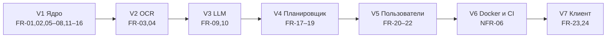

# 3. Требования к системе

> Черновик. Источник требований — `SPEC.md`, если не указано иное.
> Требования с пометкой **[предложено]** в `SPEC.md` нет; это предложение
> автора черновика, их нужно согласовать или убрать.

Уровни приоритета: **M** — обязательно (must), **S** — желательно (should),
**C** — по возможности (could).

## 3.1. Функциональные требования

### Загрузка контента

| ID | Требование | Приоритет | Версия |
|---|---|---|---|
| FR-01 | Система принимает файл субтитров `.srt` и разбивает его на реплики с таймингами (`POST /episodes`) | M | V1 |
| FR-02 | Каждая реплика хранит номер, время начала и конца, текст и принадлежность эпизоду | M | V1 |
| FR-03 | Система принимает изображение и возвращает распознанный текст (`POST /recognize`) | S | V2 |
| FR-04 | Распознанный текст попадает в тот же поток разбора, что и субтитры (общий источник текста `ITextSource`) | S | V2 |

### Разбор фразы

| ID | Требование | Приоритет | Версия |
|---|---|---|---|
| FR-05 | Система объясняет фразу из выбранной реплики (`GET /lines/{id}/explain?phrase=...`) | M | V1 |
| FR-06 | В объяснение передаётся контекст: название эпизода, текущая реплика, две предыдущие и две следующие | M | V1 |
| FR-07 | Все поля контекста необязательны; при их отсутствии объяснение строится по тому, что есть | M | V1 |
| FR-08 | Объяснитель словарный работает без ключей к внешним сервисам и используется по умолчанию | M | V1 |
| FR-09 | Объяснитель на языковой модели работает с любым OpenAI-совместимым API; адрес, модель и ключ задаются в конфигурации | S | V3 |
| FR-10 | Без настройки ключа система запускается и работает на словарном объяснителе | M | V3 |

### Словарь и повторение

| ID | Требование | Приоритет | Версия |
|---|---|---|---|
| FR-11 | Каждый разбор сохраняется как наблюдение (`Lookup`) с привязкой к реплике | M | V1 |
| FR-12 | Наблюдения одной нормализованной фразы относятся к одному элементу знания (`KnowledgeItem`) | M | V1 |
| FR-13 | Пользователь получает список сохранённого (`GET /vocabulary`) | M | V1 |
| FR-14 | Пользователь получает следующий элемент на повторение (`GET /review/next`) | M | V1 |
| FR-15 | Пользователь отвечает «помнил / не помнил», система пересчитывает интервал (`POST /review/{id}`) | M | V1 |
| FR-16 | Каждый показ и ответ сохраняется как событие (`ReviewEvent`); события не удаляются и не агрегируются при записи | M | V1 |
| FR-17 | Планировщик выбирается в конфигурации: фиксированные интервалы или адаптивный | S | V4 |
| FR-18 | Адаптивный планировщик оценивает вероятность забывания по истории `ReviewEvent` | S | V4 |
| FR-19 | Для повторения отбираются фразы, где незнакомый элемент ровно один | C | V4 |

### Пользователи

| ID | Требование | Приоритет | Версия |
|---|---|---|---|
| FR-20 | Регистрация и вход; JWT и refresh-токены | C | V5 |
| FR-21 | Данные разделены по пользователям; чужие данные недоступны | C | V5 |
| FR-22 | Лимит запросов к дорогим эндпоинтам (разбор LLM, распознавание) | C | V5 |

### Клиент

| ID | Требование | Приоритет | Версия |
|---|---|---|---|
| FR-23 | Клиент для Windows по горячей клавише захватывает область экрана, отправляет на сервер и показывает ответ | C | V7 |
| FR-24 | Клиент не содержит логики разбора и повторения | C | V7 |

## 3.2. Нефункциональные требования

| ID | Требование | Источник |
|---|---|---|
| NFR-01 | Платформа: .NET 10, ASP.NET Core minimal API | SPEC.md |
| NFR-02 | Хранилище: SQLite в файле, без отдельного сервера; схема через миграции EF Core; база создаётся при первом запуске | SPEC.md |
| NFR-03 | С чистого клона приложение запускается одной командой `dotnet run` | SPEC.md |
| NFR-04 | Внешние сервисы не обязательны для запуска: при отсутствии Tesseract или ключа LLM приложение стартует, а соответствующий эндпоинт возвращает понятную ошибку | SPEC.md |
| NFR-05 | Автотесты на xUnit; тесты LLM-части проходят без настоящего ключа на подставном HTTP-клиенте | SPEC.md |
| NFR-06 | Сборка и тесты выполняются в CI (GitHub Actions); есть Dockerfile с Tesseract | SPEC.md |
| NFR-07 | Монолит: без микросервисов | SPEC.md |
| NFR-08 | Задержка разбора фразы словарным объяснителем — не более 2 с при доступном внешнем словаре | [предложено] |
| NFR-09 | Задержка распознавания фрагмента экрана — не более 1 с на изображении до 1920×1080 | [предложено] |
| NFR-10 | Изображения с экрана не хранятся на сервере после распознавания | [предложено] |
| NFR-11 | Ключи к внешним API не хранятся в репозитории; задаются через конфигурацию или переменные окружения | [предложено] |

[предположение] Числа в NFR-08 и NFR-09 взяты «на глаз» как порог, после
которого оверлей мешает игре. Их нужно либо обосновать ссылкой на
исследования отклика интерфейсов, либо заменить измерениями на прототипе.

## 3.3. Ограничения и допущения

- [факт] Язык изучения — английский (CLAUDE.md).
- [факт] Внешний словарь — `api.dictionaryapi.dev`, бесплатный, без ключа (SPEC.md).
- [предположение] Пользователь играет в оконном или безрамочном режиме: в
  полноэкранном эксклюзивном режиме захват экрана может не работать. Для
  Translumo это прямо указано в README
  ([GitHub](https://github.com/Danily07/Translumo)) — **[сторонний для нашей
  системы]**, для нашего клиента не проверено.

## 3.4. Трассировка требований к версиям

