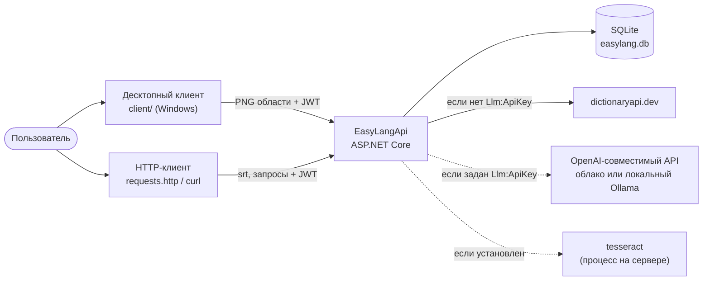
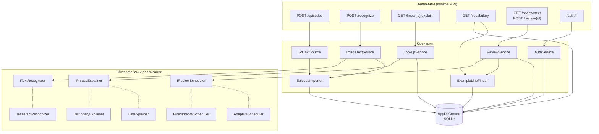
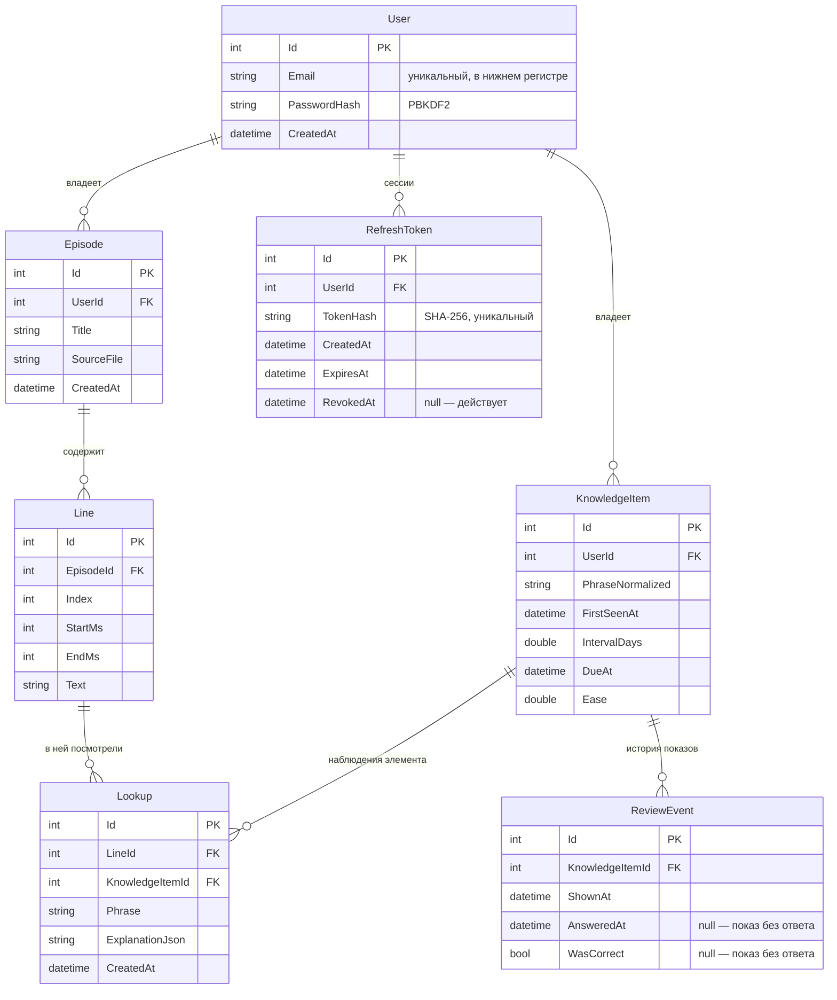
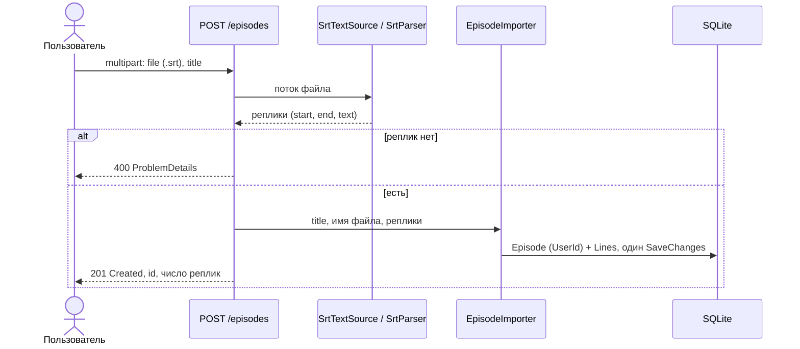
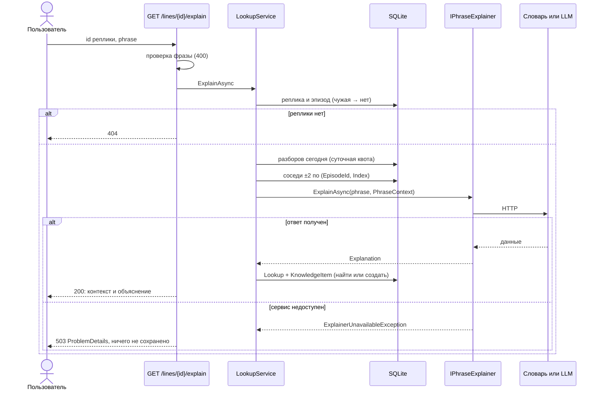
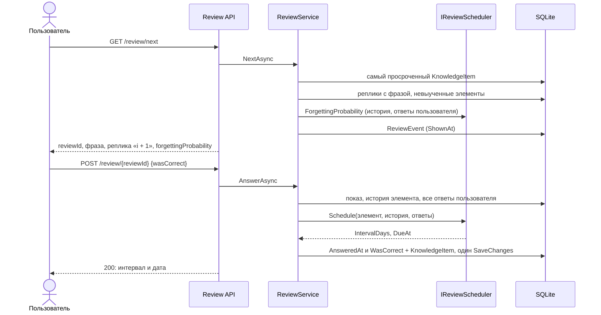
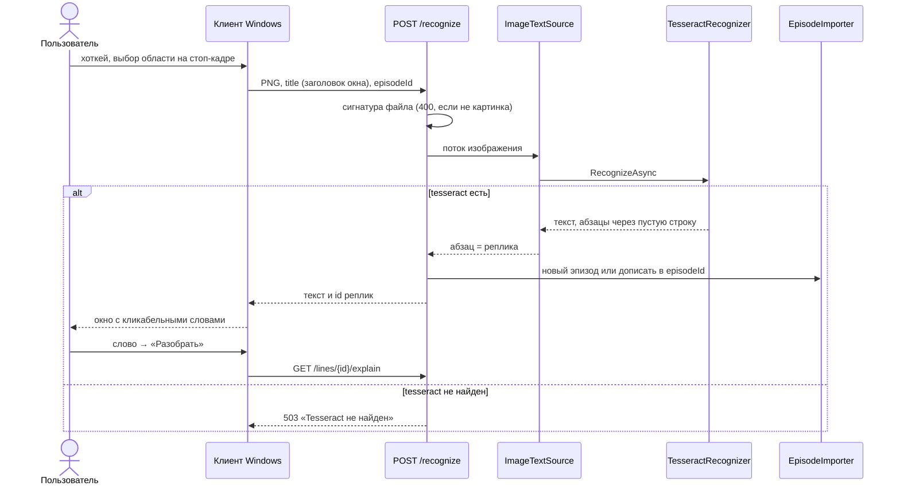
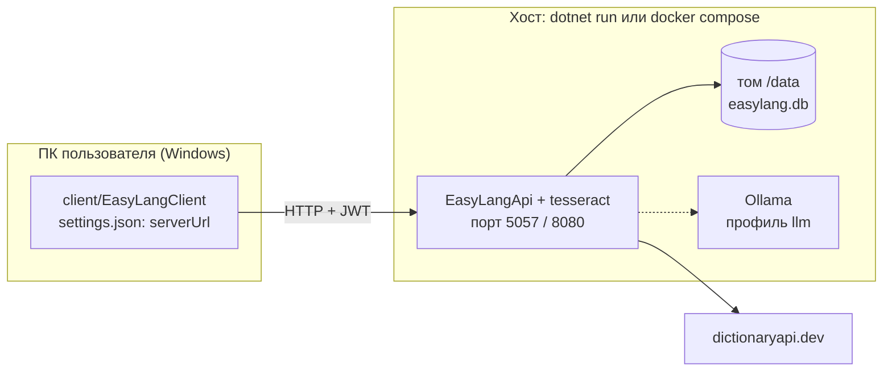

# 4. Архитектура

> Черновик. Раздел описывает **код ветки `prototype`** — версии V1–V7 из `SPEC.md`
> и обучаемый планировщик, перенесённый из `srs/`. Первая версия раздела писалась,
> когда в репозитории был только пустой проект ASP.NET Core, и описывала целевую
> архитектуру с условными именами классов. Теперь имена настоящие, пути к файлам
> даны от корня репозитория. Пометки: **[код]** — так сделано в коде;
> **[факт]** — следует из `SPEC.md` или источника; **[предположение]** — оценка автора.

## 4.1. Контекст системы

Сплошные стрелки — обязательные зависимости, пунктир — необязательные: без них
система работает в урезанном режиме (NFR-04).

[код] Без Tesseract приложение стартует, а `POST /recognize` отвечает 503 с объяснением
(`Recognition/TesseractRecognizer.cs`). Без ключа LLM работает словарь
(`Explaining/ExplainingServiceCollectionExtensions.cs`). Если же внешний сервис **выбран, но
недоступен** (словарь не отвечает, у LLM неверный ключ), запрос отвечает 503: автоматического
перехода с LLM на словарь нет.

## 4.2. Устройство кода

[код] Один проект `EasyLangApi.csproj` в корне, папки по функциям, а не по слоям. Внутри каждой
функции три уровня: эндпоинт (minimal API) → сервис со сценарием → `AppDbContext` и внешние
сервисы за интерфейсами. Отдельные проекты в духе Clean Architecture не заводились.

| Папка | Что внутри |
|---|---|
| `Data/` | `AppDbContext`, сущности, миграции EF Core, глобальные фильтры по владельцу |
| `Episodes/` | `POST /episodes`, разбор SRT (`SrtParser`), `ITextSource`, `EpisodeImporter`, имя говорящего (`SpeakerParser`) |
| `Recognition/` | `POST /recognize`, `ITextRecognizer` → `TesseractRecognizer`, `ImageTextSource` |
| `Explaining/` | `IPhraseExplainer` → `DictionaryExplainer`, `LlmExplainer`; `PromptBuilder`, `LlmResponseParser` |
| `Lookups/` | `GET /lines/{id}/explain`, `LookupService`: контекст ±2 реплики, разбор, `Lookup` + `KnowledgeItem` |
| `Vocabulary/` | `GET /vocabulary`, `GET /vocabulary/{id}/examples`, нормализация фраз (`PhraseNormalizer`) |
| `Review/` | `GET /review/next`, `POST /review/{id}`, `ReviewService`, `IReviewScheduler` → `FixedIntervalScheduler`, `AdaptiveScheduler` (`HalfLifeRegression`), отбор «i + 1» (`SingleUnknownSelector`, `ExampleLineFinder`) |
| `Auth/` | `/auth/*`, `AuthService`, `TokenService` (JWT + refresh), `ICurrentUser` |
| `Quotas/` | лимит запросов в минуту и суточная квота разборов |
| `Infrastructure/` | `KnownExceptionHandler`: ожидаемые исключения → ProblemDetails с кодом 503/422/429 |
| `client/` | клиент для Windows, отдельный проект, в сборку приложения не входит |
| `srs/` | эксперимент с планировщиками на Python и мост к C#-планировщику, в сборку приложения не входит |

Ключевой приём — **интерфейс и несколько реализаций, выбор в конфигурации**. [код] Он
повторяется трижды и опирается на встроенный контейнер зависимостей ASP.NET Core:

| Интерфейс | Реализации | Как выбирается |
|---|---|---|
| `IPhraseExplainer` | `DictionaryExplainer`, `LlmExplainer` | непустой `Llm:ApiKey` → LLM, иначе словарь |
| `ITextRecognizer` | `TesseractRecognizer` | одна реализация; в тестах подменяется |
| `IReviewScheduler` | `FixedIntervalScheduler`, `AdaptiveScheduler` | `Review:Scheduler` = `Fixed` (по умолчанию) или `Adaptive` |
| `ITextSource` | `SrtTextSource`, `ImageTextSource` | по эндпоинту: субтитры или скриншот |

Документация: [Dependency injection in ASP.NET Core](https://learn.microsoft.com/aspnet/core/fundamentals/dependency-injection).

## 4.3. Модель данных

[факт, SPEC.md] Фраза — единица показа, слово — единица учёта. Наблюдение и элемент
знания хранятся отдельно. [код] `Data/Entities.cs`, миграции `Data/Migrations/`.

Отличия от схемы в `SPEC.md` [код]:

- **`Lookup.KnowledgeItemId`** — выбран первый из двух вариантов, которые обсуждала прежняя
  версия раздела: явный внешний ключ, а не связь по нормализованной строке. Если правило
  нормализации поменяется, старые наблюдения останутся привязаны к своим элементам.
- **`UserId`** у `Episode` и `KnowledgeItem` (V5). У `Line`, `Lookup`, `ReviewEvent` владельца
  нет: он определяется через связь. Разделение данных сделано глобальными фильтрами EF Core
  (`HasQueryFilter`): любой запрос видит только строки текущего пользователя.
- **`User`, `RefreshToken`** — таблицы для входа (V5).
- `ReviewEvent.AnsweredAt` и `WasCorrect` допускают null: `GET /review/next` записывает показ,
  `POST /review/{id}` дописывает в ту же строку ответ. Показы без ответа остаются в истории.
- Время хранится в UTC; SQLite не хранит `DateTimeKind`, поэтому при чтении значения помечаются как UTC.

Индексы [код] (прежний раздел предлагал первые четыре):

| Индекс | Зачем |
|---|---|
| `Line(EpisodeId, Index)`, уникальный | соседние реплики для контекста |
| `KnowledgeItem(UserId, PhraseNormalized)`, уникальный | одна фраза — один элемент у пользователя |
| `KnowledgeItem(UserId, DueAt)` | `GET /review/next`: самый просроченный элемент |
| `ReviewEvent(KnowledgeItemId)` | история элемента. Составного `(KnowledgeItemId, ShownAt)` нет: истории короткие |
| `Users(Email)`, `RefreshTokens(TokenHash)`, уникальные | вход и обновление токена |
| `Episode(UserId)`, `Lookup(LineId)`, `Lookup(KnowledgeItemId)`, `RefreshToken(UserId)` | внешние ключи |

`ReviewEvent → KnowledgeItem` — `DeleteBehavior.Restrict`: история не удаляется каскадом.

## 4.4. Последовательности

### Загрузка субтитров

[код] Битые блоки SRT пропускаются, теги `<i>` и `{\an8}` вырезаются, строки реплики
склеиваются через пробел, `Index` — порядковый номер в файле, а не номер блока.

### Разбор фразы с контекстом

[код] `PhraseContext` — `Title`, `Speaker` (из префикса `MAYA: ...`), `Before`, `CurrentLine`,
`After`; поле `CurrentLine` добавлено к перечисленным в `SPEC.md`. Коды ответов различают
причины, как и предлагала прежняя версия раздела: 400 — фраза без слов, 404 — нет такой реплики
(или она чужая), 429 — лимит или квота, 503 — внешний сервис недоступен. «Слово не найдено»
(404 словаря) — не отказ: ответ 200 с `found: false`. Для выражения из нескольких слов так же
трактуется и 5xx словаря: показываются значения отдельных слов.

### Повторение

[код] Расхождение с рекомендацией прежней версии раздела («сначала записать событие, потом
пересчитать»): ответ и новый интервал сохраняются одним `SaveChanges`. Если планировщик
выбросит исключение, ответ не сохранится. Пока планировщики не обращаются к внешним сервисам,
это маловероятно, но полноте `ReviewEvent` (FR-16) двухшаговая запись соответствовала бы лучше.

[код] Адаптивный планировщик (`Review/AdaptiveScheduler.cs`, `Review/HalfLifeRegression.cs`) —
half-life regression из `srs/`. Веса модели нигде не хранятся: при каждом решении они заново
обучаются по всем ответам пользователя из `ReviewEvent`. Совпадение решений C# и Python
проверено в `srs/REPORT.md`, раздел «Проверка C#-планировщика».

### Распознавание с экрана (V2 + V7)

[код] Клиент дописывает скриншоты одного окна в один эпизод (`episodeId`), поэтому предыдущие
окна диалога попадают в контекст разбора как соседние реплики. Изображение сервер сохраняет
только во временный файл на время работы tesseract и затем удаляет.

Где выполнять распознавание — на клиенте или на сервере — разобрано в разделе 5.

## 4.5. Развёртывание

[код] `Dockerfile`: сборка в образе SDK, запуск в образе aspnet с `tesseract-ocr`, без root,
база в томе `/data`. `docker-compose.yml`: приложение и Ollama в профиле `llm`; секреты — из `.env`.
CI (`.github/workflows/ci.yml`): сборка и тесты с Tesseract, сборка образа и проверка, что контейнер
распознаёт `sample.png`, отдельная необязательная сборка клиента на Windows.

[факт, SPEC.md] Публичного деплоя нет.
