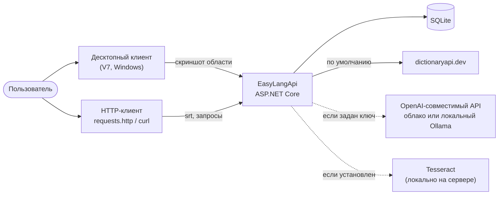
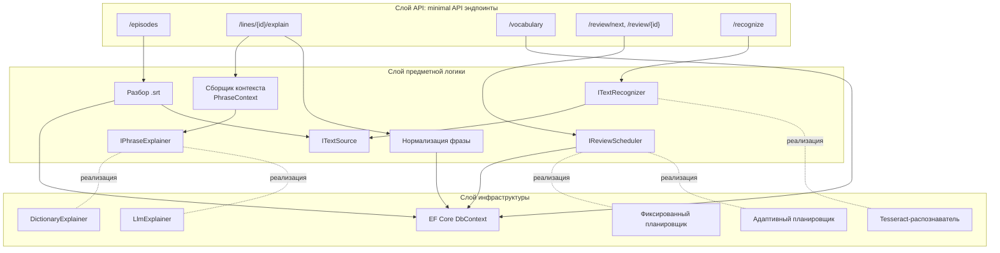
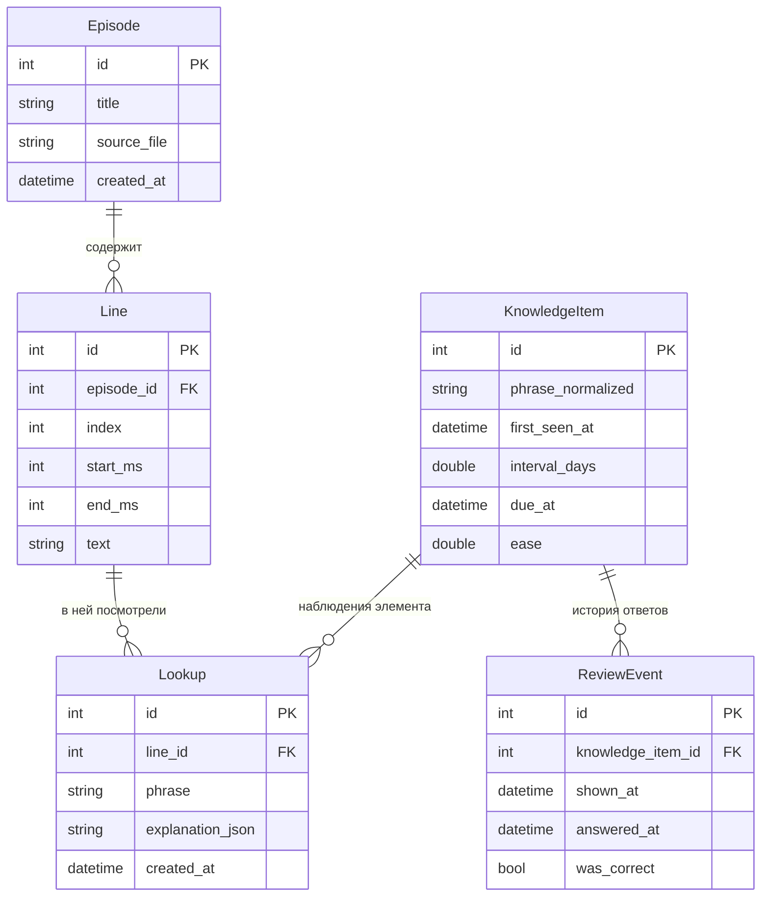
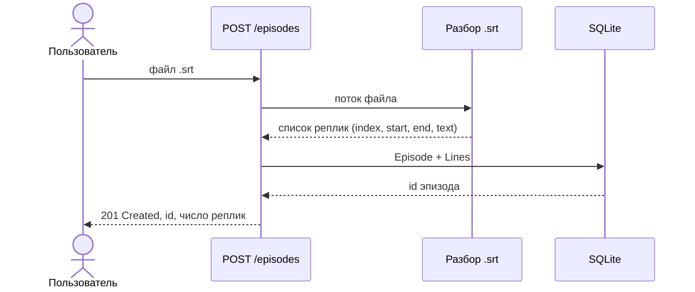
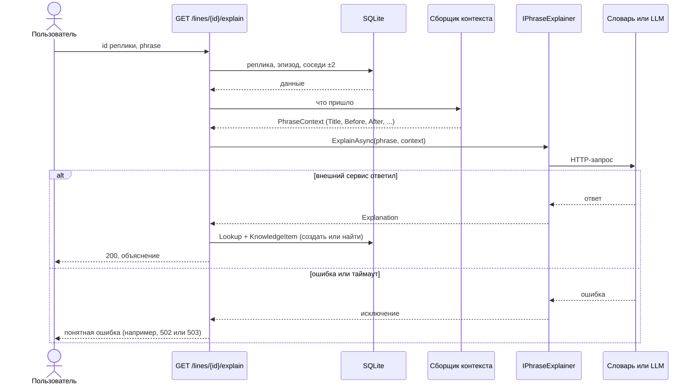
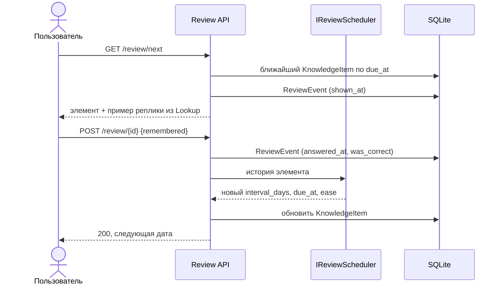
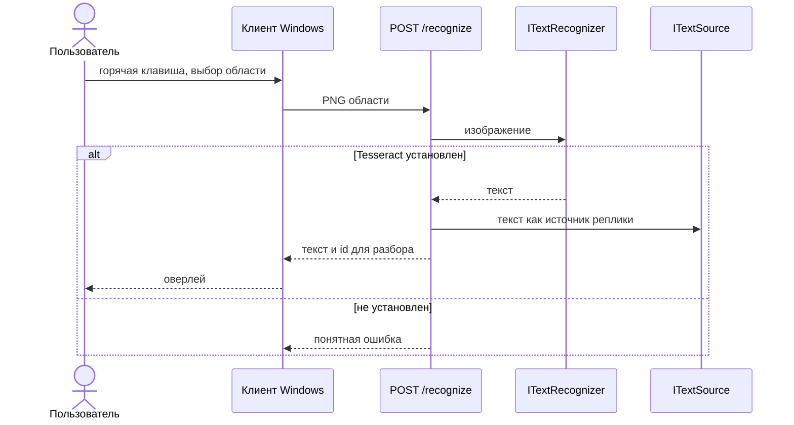
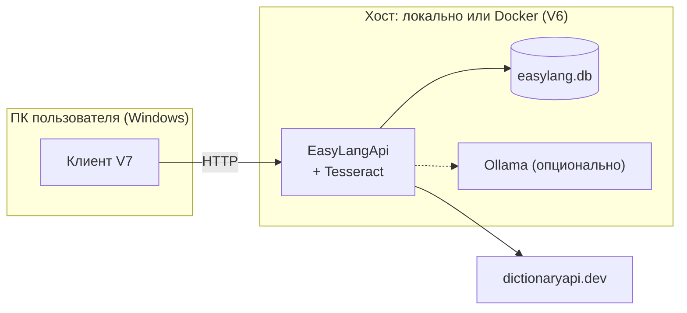

# 4. Архитектура

> Черновик. Описывает **целевую** архитектуру по `SPEC.md`. На момент
> написания в репозитории есть только пустой проект ASP.NET Core
> (`Program.cs`) — **[факт]**, проверено по содержимому репозитория.
> Всё, что ниже, — проект, а не описание готового кода. Названия классов,
> кроме интерфейсов из `SPEC.md`, условные — **[предположение]**.

## 4.1. Контекст системы

Сплошные стрелки — обязательные зависимости, пунктир — необязательные: без
них система работает в урезанном режиме (NFR-04).

## 4.2. Логические слои

[предположение] Для учебного монолита достаточно трёх слоёв внутри одного
проекта. Отдельные проекты (Clean Architecture) для прототипа избыточны.

Ключевой приём — **интерфейс и несколько реализаций, выбор в
конфигурации**. Он повторяется трижды (`IPhraseExplainer`,
`ITextRecognizer`, `IReviewScheduler`) и опирается на встроенный в ASP.NET
Core контейнер зависимостей. Для ВКР это удобная точка: одна и та же
архитектурная идея решает и плавную деградацию (нет ключа → словарь), и
эксперимент (сравнить два планировщика на одних данных).

Документация: [Dependency injection in ASP.NET Core](https://learn.microsoft.com/aspnet/core/fundamentals/dependency-injection).

## 4.3. Модель данных

[факт, SPEC.md] Фраза — единица показа, слово — единица учёта. Наблюдение и
элемент знания хранятся отдельно.

[предположение] В `SPEC.md` связь `Lookup → KnowledgeItem` явно не указана:
у `Lookup` нет поля `knowledge_item_id`. Связать их можно двумя способами:

1. добавить внешний ключ `Lookup.knowledge_item_id`;
2. связывать по значению: нормализовать `Lookup.phrase` и искать
   `KnowledgeItem.phrase_normalized`.

На диаграмме нарисован первый вариант. Это решение владельца проекта, его
нужно принять и отразить в `SPEC.md`. Вопрос для обдумывания: что
произойдёт со связью во втором варианте, если позже поменяется правило
нормализации?

[предположение] Индексы, которые понадобятся почти наверняка:
`Line(episode_id, index)` для выборки соседних реплик,
`KnowledgeItem(phrase_normalized)` уникальный,
`KnowledgeItem(due_at)` для `GET /review/next`,
`ReviewEvent(knowledge_item_id, shown_at)` для адаптивного планировщика.

## 4.4. Последовательности

### Загрузка субтитров

### Разбор фразы с контекстом

[предположение] Выбор кода ответа при отказе внешнего сервиса — хорошая
тема для разбора обработки исключений: чем ошибка «сервис словаря
недоступен» отличается от «слово не найдено» и почему у них должны быть
разные коды. См. [Handle errors in ASP.NET Core](https://learn.microsoft.com/aspnet/core/fundamentals/error-handling)
и [RFC 9457 Problem Details](https://www.rfc-editor.org/rfc/rfc9457).

### Повторение

[предположение] Порядок «сначала записать событие, потом пересчитать» важен:
даже если пересчёт упадёт, история ответов не потеряется. Это напрямую
следует из требования FR-16 о полноте `ReviewEvent`.

### Распознавание с экрана (V2 + V7)

Где выполнять распознавание — на клиенте или на сервере — разобрано в
разделе 5.

## 4.5. Развёртывание

[факт, SPEC.md] Публичного деплоя нет; `docker-compose` поднимает
приложение и опциональный Ollama.
