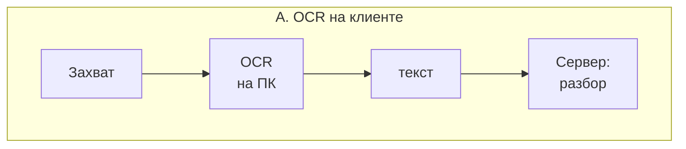
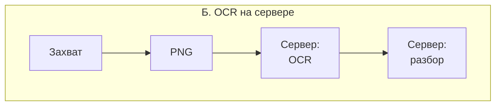
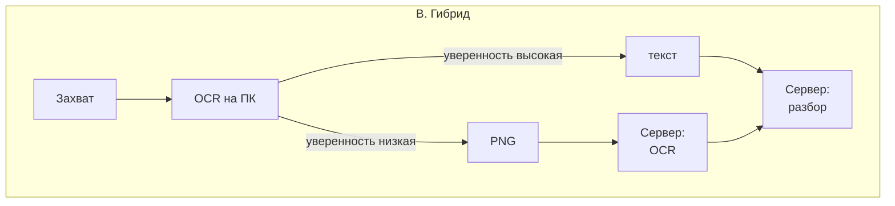

# 5. Размещение распознавания текста: клиент, сервер, гибрид

> Черновик. Пометки: **[факт]** — со ссылкой на источник; **[предположение]** —
> оценка автора, без измерений. Все числа задержек и трафика ниже —
> **оценки**, а не результаты замеров. Для ВКР их нужно заменить
> измерениями на прототипе (см. 5.6).

## 5.1. Постановка вопроса

Сценарий: пользователь в игре нажимает горячую клавишу, клиент захватывает
область экрана, система распознаёт текст и показывает разбор в оверлее.
Распознавание (OCR) можно выполнить:

- **А. на клиенте** — сервер получает уже текст;
- **Б. на сервере** — клиент отправляет изображение;
- **В. гибридно** — сначала на клиенте, на сервере при необходимости.

[факт, SPEC.md] Базовое решение проекта — вариант Б: `POST /recognize`
принимает изображение, Tesseract работает на сервере, клиент тонкий («вся
логика остаётся на сервере»). Раздел обосновывает это решение и показывает,
когда стоит перейти к гибриду.

[код] Так и реализовано: клиент (`client/`) снимает область экрана и отправляет PNG,
сервер запускает `tesseract` как внешний процесс (`Recognition/TesseractRecognizer.cs`),
абзацы распознанного текста сохраняются как реплики и разбираются тем же
`GET /lines/{id}/explain`, что и субтитры.

## 5.2. Схемы вариантов

## 5.3. Что известно о движках

| Движок | Где работает | Что подтверждено | Источник |
|---|---|---|---|
| Windows OCR (`Windows.Media.Ocr`) | только Windows, на устройстве | [факт] Набор языков — установленные на устройстве языковые пакеты (`AvailableRecognizerLanguages`); результат содержит текст, размер и положение; API поддерживается для десктопных приложений с package identity | [OcrEngine](https://learn.microsoft.com/uwp/api/windows.media.ocr.ocrengine), [пространство имён](https://learn.microsoft.com/uwp/api/windows.media.ocr) |
| Tesseract 5 | кроссплатформенный, локально | [факт] Текущая основная версия — 5.x, с 5.0.0 (30.11.2021); движок LSTM появился в 4.0; модели `tessdata`, `tessdata_best`, `tessdata_fast` | [README](https://github.com/tesseract-ocr/tesseract/blob/main/README.md), [tessdoc](https://github.com/tesseract-ocr/tessdoc) |
| EasyOCR | локально, нужен GPU Nvidia (в сборке Translumo) | [факт] В Translumo: лучше на необычных шрифтах и сложном фоне, но медленнее; требует CUDA 11.8, 8 ГБ ОЗУ, от 5 ГБ на диске | [Translumo README](https://github.com/Danily07/Translumo) |
| Облачные OCR (OCR Space и др.) | облако | [факт] Используются как вариант в Game2Text и LunaTranslator | [Game2Text](https://github.com/mathewthe2/Game2Text), [LunaTranslator](https://github.com/HIllya51/LunaTranslator) |

[факт] Опыт аналогов:
- Translumo рекомендует Windows OCR как самый эффективный по
  производительности и предлагает комбинированный режим нескольких движков
  с выбором лучшего результата
  ([README](https://github.com/Danily07/Translumo)).
- Game2Text даёт выбор между локальным Tesseract и облачным OCR Space
  ([README](https://github.com/mathewthe2/Game2Text)).
- Google Lens работает и офлайн с загруженным языковым пакетом, и онлайн
  ([9to5Google](https://9to5google.com/2021/01/25/google-lens-translate-offline/)) —
  **[сторонний]**; внутреннее распределение моделей не раскрыто.

[предположение] Всё это говорит в пользу того, что у переводчиков для игр
сложилась практика «OCR на клиенте по умолчанию». Наш прототип отступает от
неё сознательно, ради требований учебного проекта (5.5).

## 5.4. Сравнение по критериям

Оценки — **[предположение]**, если не указано иное.

| Критерий | А. Клиент | Б. Сервер | В. Гибрид |
|---|---|---|---|
| Задержка | Нет передачи изображения; OCR на ПК (Windows OCR заявлен как быстрый, [факт], Translumo) | + загрузка PNG (сотни КБ на фрагмент) + OCR на сервере; локально в одной сети незаметно, через интернет заметно | Как А в большинстве случаев, как Б на сложных кадрах |
| Нагрузка на ПК во время игры | Растёт: OCR конкурирует с игрой за CPU/GPU | Минимальная: только захват и отправка | Как А |
| Нагрузка на сервер | Только разбор текста | OCR на каждый запрос; дорогой эндпоинт, нужен лимит (FR-22) | Только на «трудных» кадрах |
| Трафик | Байты текста | Изображение на каждый запрос | В основном текст |
| Приватность | Скриншот не покидает ПК | Скриншот уходит на сервер; может содержать лишнее (ники, чат) — нужен NFR-10 | Скриншот уходит только при откате на сервер |
| Качество распознавания | Зависит от движка на ПК; у Windows OCR набор языков = установленные пакеты ([факт], MS Learn) | Одинаковое для всех клиентов; можно поставить тяжёлую модель на сервер | Лучшее из двух при правильном пороге |
| Работа без сети | Распознавание да, разбор нет | Нет | Распознавание да |
| Сложность клиента | Высокая: OCR, языковые пакеты, версии Windows | Низкая: соответствует «вся логика на сервере» (SPEC.md) | Самая высокая: два пути, порог уверенности |
| Тестируемость в CI | Windows OCR в Linux-CI не запустить | Tesseract в Docker и CI (V6) | Серверная часть — как Б, клиентская — как А |
| Воспроизводимость эксперимента | Результат зависит от машины пользователя | Один движок, одна версия, одни настройки | Нужно логировать, каким путём шёл кадр |
| Соответствие учебной цели | Логика уходит в клиент, который генерируется | Логика в бэкенде, который пишется вручную (CLAUDE.md) | Частично |

## 5.5. Рекомендация

**Для прототипа и ВКР — вариант Б (сервер)** — это решение уже
зафиксировано в `SPEC.md`; ниже его обоснование.

1. [факт, CLAUDE.md/SPEC.md] Бэкенд — основная часть, клиент вспомогательный;
   вся логика на сервере. OCR на сервере сохраняет это разделение.
2. [факт, SPEC.md] Тесты распознавания должны работать на изображениях,
   сгенерированных в самом тесте, а сборка — в CI с Docker и Tesseract.
   Это выполнимо только при серверном OCR. [код] Выполнено: картинки рисует SkiaSharp
   в тесте, GitHub Actions ставит Tesseract и запускает эти тесты; отдельное задание
   собирает Docker-образ и проверяет, что контейнер распознаёт `sample.png`.
3. [предположение] Для эксперимента (CER на наборе скриншотов) нужен один
   воспроизводимый движок, а не «то, что стоит у пользователя».
4. [предположение] Сервер в сценарии прототипа — локальный процесс или
   Docker на той же машине, поэтому основной минус варианта Б (передача
   изображения через интернет) почти не проявляется.

**Для развития после ВКР — гибрид (В).** Клиент распознаёт через Windows OCR,
а при низкой уверенности или по запросу пользователя отправляет изображение
на сервер. Серверный контракт для этого уже есть: `POST /recognize` для
изображения и общий `ITextSource` для текста. [предположение] Понадобится
только эндпоинт, принимающий готовый текст от клиента, и поле «откуда
пришёл текст» в данных — для анализа качества. [код] Ни того ни другого пока нет.

Вопрос для самопроверки при защите: как в гибриде определить «низкую
уверенность», если движки на клиенте и на сервере возвращают оценки в разных
шкалах?

## 5.6. Что измерить, чтобы заменить оценки фактами

[код] Одно измерение уже есть, и оно касается варианта Б. Распознавание `sample.png`
(1200×260, две строки) командой `tesseract sample.png stdout -l eng` в облачном контейнере
с 4 ядрами, когда все ядра заняты другими процессами: **18,4 с** с настройками по умолчанию
и **0,12 с** с `OMP_THREAD_LIMIT=1`. По одному замеру на вариант, это не статистика,
но разница в 150 раз. Вывод для сервера: многопоточный Tesseract плохо переносит параллельные
запросы и чужую нагрузку на CPU. В коде поэтому потоки ограничены по умолчанию
(`Ocr:ThreadLimit = 1`). Повторить замер нужно на сервере без посторонней нагрузки
и при нескольких одновременных запросах.

- [ ] Время `POST /recognize` от отправки до ответа на изображениях 400×100,
      800×200, 1920×1080 — локально и через сеть.
- [ ] Размер PNG для тех же фрагментов.
- [ ] CER Tesseract на наборе скриншотов из 2–3 игр с разными шрифтами.
- [ ] (по возможности, на Windows) CER и время Windows OCR на том же наборе.
- [ ] Загрузка CPU во время игры при OCR на клиенте и без него.

## 5.7. Источники раздела

- Microsoft Learn. OcrEngine Class. <https://learn.microsoft.com/uwp/api/windows.media.ocr.ocrengine>
- Microsoft Learn. Windows.Media.Ocr Namespace. <https://learn.microsoft.com/uwp/api/windows.media.ocr>
- Tesseract OCR, README. <https://github.com/tesseract-ocr/tesseract/blob/main/README.md>
- Tesseract documentation (tessdoc). <https://github.com/tesseract-ocr/tessdoc>
- Translumo, README. <https://github.com/Danily07/Translumo>
- Game2Text, README. <https://github.com/mathewthe2/Game2Text>
- LunaTranslator, README. <https://github.com/HIllya51/LunaTranslator>
- 9to5Google. Google Lens offline translate (2021). <https://9to5google.com/2021/01/25/google-lens-translate-offline/>
