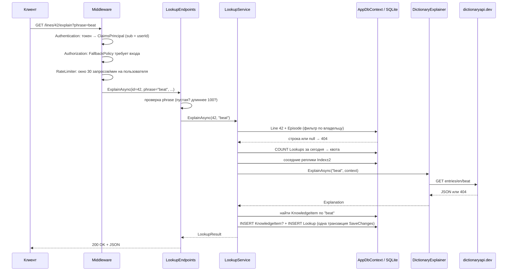

# Руководство по проекту EasyLangApi

Для студента, который знает C# на базовом уровне и будет защищать этот проект
на собеседовании и на ВКР.

Цель руководства — чтобы вы могли **объяснить и переписать сами любую строку**
проекта. Поэтому здесь нет готового кода для доработок. Есть порядок чтения,
разбор устройства, вопросы для самопроверки и задачи, которые нужно сделать
самостоятельно.

> Руководство написано по ветке `prototype` (коммит `028dd32`). Ссылки вида
> `Lookups/LookupService.cs:30` указывают на эту версию; после правок номера
> строк могут сдвинуться. Тесты при написании руководства не запускались
> (в среде не было .NET SDK). Сведения о том, что проверено, взяты из
> `STATUS.md`: там указано 126 зелёных тестов.

## Содержание

1. [Порядок чтения файлов](#1-порядок-чтения-файлов)
2. [Путь одного запроса: от эндпоинта до базы](#2-путь-одного-запроса-от-эндпоинта-до-базы)
3. [Архитектурные решения и альтернативы](#3-архитектурные-решения-и-альтернативы)
4. [30 вопросов собеседования с ответами](#4-30-вопросов-собеседования-с-ответами)
5. [10 задач на доработку](#5-10-задач-на-доработку)

---

## 1. Порядок чтения файлов

Читайте **по слоям сверху вниз и по одному сценарию за раз**, а не по папкам
в алфавитном порядке. После каждого шага закройте файл и попробуйте
пересказать вслух, что он делает. Не получается — читайте снова.

### Шаг 0. Зачем всё это (15 минут)

| Файл | На что смотреть |
|---|---|
| `SPEC.md` | Поток из шести шагов и модель данных. Запомните фразу «фраза — единица показа, слово — единица учёта» |
| `README.md` | Как запустить, какие эндпоинты есть |
| `STATUS.md` | Что проверено, а что только написано. На защите важно не выдать непроверенное за работающее |

### Шаг 1. Точка входа (20 минут)

| Файл | На что смотреть |
|---|---|
| `Program.cs` | Две половины: до `builder.Build()` идёт регистрация сервисов (DI), после — конвейер middleware и маршруты. Для каждой строки `AddScoped/AddSingleton` ответьте, почему выбрано это время жизни |
| `appsettings.json` | Все настройки. Сопоставьте каждую секцию с классом `*Options` |
| `EasyLangApi.csproj` | Зависимости и почему из сборки исключены `tests/`, `client/`, `docs/` |

### Шаг 2. Данные (30 минут)

| Файл | На что смотреть |
|---|---|
| `Data/Entities.cs` | Семь сущностей. Нарисуйте на бумаге связи между ними |
| `Data/AppDbContext.cs` | Индексы, глобальные фильтры по пользователю, `OnDelete(Restrict)` для истории, конвертер UTC |
| `Data/DatabaseExtensions.cs` | Миграции при старте |
| `Data/Migrations/*_InitialCreate.cs` | Какой SQL получается из модели. Посмотрите, во что превратились индексы |
| `Data/Migrations/*_AddUsers.cs` | Как старые данные переехали к служебному пользователю `legacy@localhost` |

### Шаг 3. Сценарий «загрузить субтитры» (30 минут)

`Episodes/EpisodeEndpoints.cs` → `Episodes/SrtTextSource.cs` →
`Episodes/SrtParser.cs` → `Episodes/EpisodeImporter.cs`.
Параллельно читайте `tests/.../Unit/SrtParserTests.cs`: тесты показывают,
какие крайние случаи учтены.

### Шаг 4. Сценарий «разобрать фразу» — главный (60 минут)

1. `Lookups/LookupEndpoints.cs` — проверка входа.
2. `Lookups/LookupService.cs` — сценарий целиком.
3. `Explaining/IPhraseExplainer.cs`, `PhraseContext.cs`, `Explanation.cs` — контракт.
4. `Explaining/ExplainingServiceCollectionExtensions.cs` — как выбирается реализация.
5. `Explaining/DictionaryExplainer.cs` — реализация по умолчанию: `HttpClient`, `async/await`, обработка ошибок.
6. `Explaining/ExplainerUnavailableException.cs` + `Infrastructure/KnownExceptionHandler.cs` — как исключение становится ответом 503.
7. `Vocabulary/PhraseNormalizer.cs` — по какому ключу ищется `KnowledgeItem`.
8. `Episodes/SpeakerParser.cs` — откуда берётся `Speaker`.

Тесты к сценарию: `Api/FlowTests.cs`, `Unit/DictionaryExplainerTests.cs`,
`Unit/PhraseNormalizerTests.cs`.

### Шаг 5. Сценарий «повторить» (45 минут)

`Review/ReviewEndpoints.cs` → `Review/ReviewService.cs` →
`Review/IReviewScheduler.cs` → `Review/FixedIntervalScheduler.cs` +
`Review/IntervalLadder.cs`. Затем `Review/ExampleLineFinder.cs` и
`Review/SingleUnknownSelector.cs` (отбор «i + 1»).

`Review/AdaptiveScheduler.cs` оставьте на отдельный день: там математика
(см. вопросы 24–26).

### Шаг 6. Языковая модель (40 минут)

`Explaining/LlmExplainer.cs` → `PromptBuilder.cs` → `LlmResponseParser.cs`
→ `ExplainerOptions.cs`. Тесты: `Unit/LlmExplainerTests.cs`,
`Infrastructure/StubHttpHandler.cs` — как проверить HTTP-клиент без сети.

### Шаг 7. Распознавание (30 минут)

`Recognition/RecognitionEndpoints.cs` → `ImageFormat.cs` →
`ImageTextSource.cs` → `TesseractRecognizer.cs` → `RecognitionExceptions.cs`.

### Шаг 8. Пользователи и квоты (60 минут)

`Auth/AuthServiceCollectionExtensions.cs` → `AuthEndpoints.cs` →
`AuthService.cs` → `TokenService.cs` → `SigningKeyProvider.cs` →
`ICurrentUser.cs`. Затем `Quotas/*`. Тесты: `Api/AuthTests.cs`,
`Api/IsolationTests.cs`, `Api/QuotaTests.cs`.

### Шаг 9. Тестовая инфраструктура (30 минут)

`tests/.../Infrastructure/ApiFactory.cs` — как приложение поднимается в
памяти, со своей базой и подставными часами. `FakeExplainer.cs`,
`FakeRecognizer.cs`, `TextImages.cs`.

### Шаг 10. Окружение (20 минут)

`Dockerfile`, `docker-compose.yml`, `.github/workflows/ci.yml`.
Клиент `client/` — по желанию: его можно генерировать, на защите основной
акцент на сервере.

### Темы, которые нужно подтянуть по дороге

| Когда встретите | Что почитать |
|---|---|
| `async`, `await`, `Task`, `CancellationToken` (везде) | [Асинхронное программирование в C#](https://learn.microsoft.com/dotnet/csharp/asynchronous-programming/) |
| `HttpClient`, `AddHttpClient` (шаг 4) | [IHttpClientFactory](https://learn.microsoft.com/dotnet/core/extensions/httpclient-factory) |
| `.Where(...).Select(...)`, лямбды (шаги 2–5) | [LINQ](https://learn.microsoft.com/dotnet/csharp/linq/) |
| `try/catch ... when`, свои исключения (шаг 4) | [Исключения: рекомендации](https://learn.microsoft.com/dotnet/standard/exceptions/best-practices-for-exceptions) |
| Индексы, `LIKE`, SQL из миграций (шаг 2) | [SQLite: Query Planning](https://www.sqlite.org/queryplanner.html) |
| `DbContext`, `Include`, `SaveChangesAsync` | [EF Core: начало работы](https://learn.microsoft.com/ef/core/get-started/overview/first-app) |
| `AddScoped`, `AddSingleton` (шаг 1) | [Внедрение зависимостей в ASP.NET Core](https://learn.microsoft.com/aspnet/core/fundamentals/dependency-injection) |

---

## 2. Путь одного запроса: от эндпоинта до базы

Разберём главный запрос: `GET /lines/42/explain?phrase=beat` с заголовком
`Authorization: Bearer <токен>`.

### 2.1. Общая картина

### 2.2. По шагам

**1. Middleware** (`Program.cs`, блок после `builder.Build()`).
Запрос проходит конвейер в порядке регистрации:

- `UseExceptionHandler()` — внешний слой: ловит всё, что вылетит ниже, и
  отдаёт ProblemDetails. Стоит первым, потому что ловит только то, что
  находится *после* него.
- `UseStatusCodePages()` — пустые ответы 404/401 получают тело.
- `UseAuthentication()` — читает заголовок `Authorization`, проверяет
  подпись и срок JWT, кладёт пользователя в `HttpContext.User`.
- `UseAuthorization()` — применяет политику. Эндпоинт не помечен
  `AllowAnonymous`, поэтому срабатывает `FallbackPolicy` из
  `Auth/AuthServiceCollectionExtensions.cs`: без входа будет 401.
- `UseRateLimiter()` — стоит **после** аутентификации, потому что ключ
  лимита — id пользователя из токена (`Quotas/RateLimitingExtensions.cs`).
  Политику `expensive` подключает сам эндпоинт: `.RequireRateLimiting(...)`.

**2. Привязка параметров** (`Lookups/LookupEndpoints.cs`).
Minimal API сам разбирает аргументы метода `ExplainAsync`:
- `int id` — из маршрута `{id:int}`; ограничение `:int` даёт 404 на `/lines/abc/explain`;
- `string? phrase` — из строки запроса;
- `LookupService lookups` — из DI-контейнера;
- `CancellationToken` — отменяется, если клиент оборвал соединение.

Тип возврата `Results<Ok<LookupResult>, NotFound, ProblemHttpResult>`
перечисляет все возможные ответы. Компилятор не даст вернуть что-то другое,
а OpenAPI-описание получается точным.

**3. Проверка входа** — там же. Пустая фраза или фраза из одних знаков
препинания отклоняется с 400. Проверка идёт через `PhraseNormalizer`,
а не через `string.IsNullOrWhiteSpace`. Подумайте, почему (подсказка: что
получится из фразы `"!!!"`).

**4. Сервис** (`Lookups/LookupService.cs`, метод `ExplainAsync`).

- Создание. `LookupService` зарегистрирован как `Scoped`: на каждый запрос
  создаётся новый экземпляр со своим `AppDbContext`. Зависимости приходят
  через первичный конструктор `LookupService(AppDbContext db, ...)`.
- Реплика. `db.Lines.Include(l => l.Episode).FirstOrDefaultAsync(...)`
  превращается в один `SELECT ... JOIN`. Глобальный фильтр из
  `AppDbContext` сам дописывает условие «эпизод принадлежит текущему
  пользователю». Чужая реплика вернётся как `null`, и наружу уйдёт 404.
- Квота. `EnsureDailyQuotaAsync` считает `Lookup` за текущие сутки по UTC.
  Если лимит исчерпан, бросает `QuotaExceededException`, и
  `KnownExceptionHandler` превращает её в 429.
- Контекст. `BuildContextAsync` делает один запрос по составному индексу
  `(EpisodeId, Index)` и разбивает результат на «до» и «после» в памяти.
- Объяснение. `explainer.ExplainAsync(...)` — сервису неизвестно, словарь
  это или языковая модель: он видит только `IPhraseExplainer`.

**5. Внешний HTTP** (`Explaining/DictionaryExplainer.cs`, `FetchAsync`).

- `HttpClient` получен через `AddHttpClient<DictionaryExplainer>`: базовый
  адрес и таймаут заданы при регистрации.
- Ответ 404 возвращается как `null`. Это нормальная ситуация: слова нет в
  словаре.
- Обрыв сети (`HttpRequestException`), таймаут (`TaskCanceledException`,
  когда отменил не клиент), код 5xx и битый JSON заворачиваются в
  `ExplainerUnavailableException`. Наружу она уходит как **503**: «сервис
  временно недоступен, повторите».

**6. Запись** — снова `LookupService`.

- `KnowledgeItem` ищется по нормализованной фразе. Если не найден,
  создаётся с `DueAt = now`, то есть его можно повторить сразу.
- `Lookup` создаётся всегда: это наблюдение «посмотрел вот это вот здесь».
- Один `SaveChangesAsync` записывает оба объекта в одной транзакции.
  EF сам расставит внешние ключи, потому что объекты связаны навигационными
  свойствами (`Line = line`, `KnowledgeItem = item`), а не через id.

**7. Ответ.** `TypedResults.Ok(result)` сериализуется в JSON в camelCase.

### 2.3. Что получится в SQL

Включите логирование команд: в `appsettings.Development.json` задайте
`"Microsoft.EntityFrameworkCore.Database.Command": "Information"`. Затем
выполните запрос из `requests.http` и найдите в консоли:

1. `SELECT` реплики с `INNER JOIN "Episodes"` и условием на `UserId`;
2. `SELECT COUNT(*)` для квоты;
3. `SELECT` соседей с `BETWEEN`-подобным условием на `Index`;
4. `SELECT` элемента по `PhraseNormalized`;
5. `INSERT` в `KnowledgeItems` (если элемент новый) и `INSERT` в `Lookups`.

**Упражнение:** посчитайте, сколько обращений к базе делает один разбор.
Какие из них можно объединить, а какие нельзя и почему?

### 2.4. Если что-то пошло не так

| Ситуация | Где решается | Код |
|---|---|---|
| Нет токена или он просрочен | `UseAuthentication` + `FallbackPolicy` | 401 |
| Больше 30 запросов в минуту | `UseRateLimiter`, `OnRejected` | 429 + `Retry-After` |
| `phrase` пустая или длинная | `LookupEndpoints` | 400 |
| Реплика чужая или её нет | глобальный фильтр → `null` | 404 |
| Квота на сутки исчерпана | `QuotaExceededException` → `KnownExceptionHandler` | 429 |
| Словарь недоступен | `ExplainerUnavailableException` → `KnownExceptionHandler` | 503 |
| Ошибка в нашем коде | `UseExceptionHandler` | 500 |

Заметьте: при 503 **ничего не сохраняется**, потому что исключение
вылетает до `SaveChangesAsync`.
