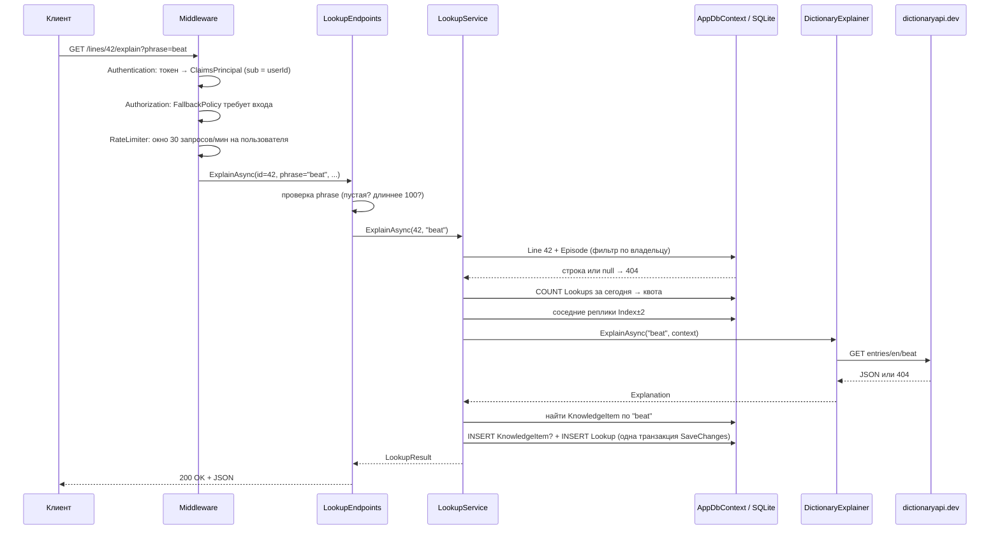

# Руководство по проекту EasyLangApi

Для студента, который знает C# на базовом уровне и будет защищать этот проект
на собеседовании и на ВКР.

Цель руководства — чтобы вы могли **объяснить и переписать сами любую строку**
проекта. Поэтому здесь нет готового кода для доработок. Есть порядок чтения,
разбор устройства, вопросы для самопроверки и задачи, которые нужно сделать
самостоятельно.

> Руководство написано по ветке `prototype` (коммит `028dd32`). Ссылки вида
> `Lookups/LookupService.cs:30` указывают на эту версию; после правок номера
> строк могут сдвинуться. Тесты при написании руководства не запускались
> (в среде не было .NET SDK). Сведения о том, что проверено, взяты из
> `STATUS.md`: там указано 126 зелёных тестов.

## Содержание

1. [Порядок чтения файлов](#1-порядок-чтения-файлов)
2. [Путь одного запроса: от эндпоинта до базы](#2-путь-одного-запроса-от-эндпоинта-до-базы)
3. [Архитектурные решения и альтернативы](#3-архитектурные-решения-и-альтернативы)
4. [30 вопросов собеседования с ответами](#4-30-вопросов-собеседования-с-ответами)
5. [10 задач на доработку](#5-10-задач-на-доработку)

---

## 1. Порядок чтения файлов

Читайте **по слоям сверху вниз и по одному сценарию за раз**, а не по папкам
в алфавитном порядке. После каждого шага закройте файл и попробуйте
пересказать вслух, что он делает. Не получается — читайте снова.

### Шаг 0. Зачем всё это (15 минут)

| Файл | На что смотреть |
|---|---|
| `SPEC.md` | Поток из шести шагов и модель данных. Запомните фразу «фраза — единица показа, слово — единица учёта» |
| `README.md` | Как запустить, какие эндпоинты есть |
| `STATUS.md` | Что проверено, а что только написано. На защите важно не выдать непроверенное за работающее |

### Шаг 1. Точка входа (20 минут)

| Файл | На что смотреть |
|---|---|
| `Program.cs` | Две половины: до `builder.Build()` идёт регистрация сервисов (DI), после — конвейер middleware и маршруты. Для каждой строки `AddScoped/AddSingleton` ответьте, почему выбрано это время жизни |
| `appsettings.json` | Все настройки. Сопоставьте каждую секцию с классом `*Options` |
| `EasyLangApi.csproj` | Зависимости и почему из сборки исключены `tests/`, `client/`, `docs/` |

### Шаг 2. Данные (30 минут)

| Файл | На что смотреть |
|---|---|
| `Data/Entities.cs` | Семь сущностей. Нарисуйте на бумаге связи между ними |
| `Data/AppDbContext.cs` | Индексы, глобальные фильтры по пользователю, `OnDelete(Restrict)` для истории, конвертер UTC |
| `Data/DatabaseExtensions.cs` | Миграции при старте |
| `Data/Migrations/*_InitialCreate.cs` | Какой SQL получается из модели. Посмотрите, во что превратились индексы |
| `Data/Migrations/*_AddUsers.cs` | Как старые данные переехали к служебному пользователю `legacy@localhost` |

### Шаг 3. Сценарий «загрузить субтитры» (30 минут)

`Episodes/EpisodeEndpoints.cs` → `Episodes/SrtTextSource.cs` →
`Episodes/SrtParser.cs` → `Episodes/EpisodeImporter.cs`.
Параллельно читайте `tests/.../Unit/SrtParserTests.cs`: тесты показывают,
какие крайние случаи учтены.

### Шаг 4. Сценарий «разобрать фразу» — главный (60 минут)

1. `Lookups/LookupEndpoints.cs` — проверка входа.
2. `Lookups/LookupService.cs` — сценарий целиком.
3. `Explaining/IPhraseExplainer.cs`, `PhraseContext.cs`, `Explanation.cs` — контракт.
4. `Explaining/ExplainingServiceCollectionExtensions.cs` — как выбирается реализация.
5. `Explaining/DictionaryExplainer.cs` — реализация по умолчанию: `HttpClient`, `async/await`, обработка ошибок.
6. `Explaining/ExplainerUnavailableException.cs` + `Infrastructure/KnownExceptionHandler.cs` — как исключение становится ответом 503.
7. `Vocabulary/PhraseNormalizer.cs` — по какому ключу ищется `KnowledgeItem`.
8. `Episodes/SpeakerParser.cs` — откуда берётся `Speaker`.

Тесты к сценарию: `Api/FlowTests.cs`, `Unit/DictionaryExplainerTests.cs`,
`Unit/PhraseNormalizerTests.cs`.

### Шаг 5. Сценарий «повторить» (45 минут)

`Review/ReviewEndpoints.cs` → `Review/ReviewService.cs` →
`Review/IReviewScheduler.cs` → `Review/FixedIntervalScheduler.cs` +
`Review/IntervalLadder.cs`. Затем `Review/ExampleLineFinder.cs` и
`Review/SingleUnknownSelector.cs` (отбор «i + 1»).

`Review/AdaptiveScheduler.cs` оставьте на отдельный день: там математика
(см. вопросы 24–26).

### Шаг 6. Языковая модель (40 минут)

`Explaining/LlmExplainer.cs` → `PromptBuilder.cs` → `LlmResponseParser.cs`
→ `ExplainerOptions.cs`. Тесты: `Unit/LlmExplainerTests.cs`,
`Infrastructure/StubHttpHandler.cs` — как проверить HTTP-клиент без сети.

### Шаг 7. Распознавание (30 минут)

`Recognition/RecognitionEndpoints.cs` → `ImageFormat.cs` →
`ImageTextSource.cs` → `TesseractRecognizer.cs` → `RecognitionExceptions.cs`.

### Шаг 8. Пользователи и квоты (60 минут)

`Auth/AuthServiceCollectionExtensions.cs` → `AuthEndpoints.cs` →
`AuthService.cs` → `TokenService.cs` → `SigningKeyProvider.cs` →
`ICurrentUser.cs`. Затем `Quotas/*`. Тесты: `Api/AuthTests.cs`,
`Api/IsolationTests.cs`, `Api/QuotaTests.cs`.

### Шаг 9. Тестовая инфраструктура (30 минут)

`tests/.../Infrastructure/ApiFactory.cs` — как приложение поднимается в
памяти, со своей базой и подставными часами. `FakeExplainer.cs`,
`FakeRecognizer.cs`, `TextImages.cs`.

### Шаг 10. Окружение (20 минут)

`Dockerfile`, `docker-compose.yml`, `.github/workflows/ci.yml`.
Клиент `client/` — по желанию: его можно генерировать, на защите основной
акцент на сервере.

### Темы, которые нужно подтянуть по дороге

| Когда встретите | Что почитать |
|---|---|
| `async`, `await`, `Task`, `CancellationToken` (везде) | [Асинхронное программирование в C#](https://learn.microsoft.com/dotnet/csharp/asynchronous-programming/) |
| `HttpClient`, `AddHttpClient` (шаг 4) | [IHttpClientFactory](https://learn.microsoft.com/dotnet/core/extensions/httpclient-factory) |
| `.Where(...).Select(...)`, лямбды (шаги 2–5) | [LINQ](https://learn.microsoft.com/dotnet/csharp/linq/) |
| `try/catch ... when`, свои исключения (шаг 4) | [Исключения: рекомендации](https://learn.microsoft.com/dotnet/standard/exceptions/best-practices-for-exceptions) |
| Индексы, `LIKE`, SQL из миграций (шаг 2) | [SQLite: Query Planning](https://www.sqlite.org/queryplanner.html) |
| `DbContext`, `Include`, `SaveChangesAsync` | [EF Core: начало работы](https://learn.microsoft.com/ef/core/get-started/overview/first-app) |
| `AddScoped`, `AddSingleton` (шаг 1) | [Внедрение зависимостей в ASP.NET Core](https://learn.microsoft.com/aspnet/core/fundamentals/dependency-injection) |

---

## 2. Путь одного запроса: от эндпоинта до базы

Разберём главный запрос: `GET /lines/42/explain?phrase=beat` с заголовком
`Authorization: Bearer <токен>`.

### 2.1. Общая картина

### 2.2. По шагам

**1. Middleware** (`Program.cs`, блок после `builder.Build()`).
Запрос проходит конвейер в порядке регистрации:

- `UseExceptionHandler()` — внешний слой: ловит всё, что вылетит ниже, и
  отдаёт ProblemDetails. Стоит первым, потому что ловит только то, что
  находится *после* него.
- `UseStatusCodePages()` — пустые ответы 404/401 получают тело.
- `UseAuthentication()` — читает заголовок `Authorization`, проверяет
  подпись и срок JWT, кладёт пользователя в `HttpContext.User`.
- `UseAuthorization()` — применяет политику. Эндпоинт не помечен
  `AllowAnonymous`, поэтому срабатывает `FallbackPolicy` из
  `Auth/AuthServiceCollectionExtensions.cs`: без входа будет 401.
- `UseRateLimiter()` — стоит **после** аутентификации, потому что ключ
  лимита — id пользователя из токена (`Quotas/RateLimitingExtensions.cs`).
  Политику `expensive` подключает сам эндпоинт: `.RequireRateLimiting(...)`.

**2. Привязка параметров** (`Lookups/LookupEndpoints.cs`).
Minimal API сам разбирает аргументы метода `ExplainAsync`:
- `int id` — из маршрута `{id:int}`; ограничение `:int` даёт 404 на `/lines/abc/explain`;
- `string? phrase` — из строки запроса;
- `LookupService lookups` — из DI-контейнера;
- `CancellationToken` — отменяется, если клиент оборвал соединение.

Тип возврата `Results<Ok<LookupResult>, NotFound, ProblemHttpResult>`
перечисляет все возможные ответы. Компилятор не даст вернуть что-то другое,
а OpenAPI-описание получается точным.

**3. Проверка входа** — там же. Пустая фраза или фраза из одних знаков
препинания отклоняется с 400. Проверка идёт через `PhraseNormalizer`,
а не через `string.IsNullOrWhiteSpace`. Подумайте, почему (подсказка: что
получится из фразы `"!!!"`).

**4. Сервис** (`Lookups/LookupService.cs`, метод `ExplainAsync`).

- Создание. `LookupService` зарегистрирован как `Scoped`: на каждый запрос
  создаётся новый экземпляр со своим `AppDbContext`. Зависимости приходят
  через первичный конструктор `LookupService(AppDbContext db, ...)`.
- Реплика. `db.Lines.Include(l => l.Episode).FirstOrDefaultAsync(...)`
  превращается в один `SELECT ... JOIN`. Глобальный фильтр из
  `AppDbContext` сам дописывает условие «эпизод принадлежит текущему
  пользователю». Чужая реплика вернётся как `null`, и наружу уйдёт 404.
- Квота. `EnsureDailyQuotaAsync` считает `Lookup` за текущие сутки по UTC.
  Если лимит исчерпан, бросает `QuotaExceededException`, и
  `KnownExceptionHandler` превращает её в 429.
- Контекст. `BuildContextAsync` делает один запрос по составному индексу
  `(EpisodeId, Index)` и разбивает результат на «до» и «после» в памяти.
- Объяснение. `explainer.ExplainAsync(...)` — сервису неизвестно, словарь
  это или языковая модель: он видит только `IPhraseExplainer`.

**5. Внешний HTTP** (`Explaining/DictionaryExplainer.cs`, `FetchAsync`).

- `HttpClient` получен через `AddHttpClient<DictionaryExplainer>`: базовый
  адрес и таймаут заданы при регистрации.
- Ответ 404 возвращается как `null`. Это нормальная ситуация: слова нет в
  словаре.
- Обрыв сети (`HttpRequestException`), таймаут (`TaskCanceledException`,
  когда отменил не клиент), код 5xx и битый JSON заворачиваются в
  `ExplainerUnavailableException`. Наружу она уходит как **503**: «сервис
  временно недоступен, повторите».

**6. Запись** — снова `LookupService`.

- `KnowledgeItem` ищется по нормализованной фразе. Если не найден,
  создаётся с `DueAt = now`, то есть его можно повторить сразу.
- `Lookup` создаётся всегда: это наблюдение «посмотрел вот это вот здесь».
- Один `SaveChangesAsync` записывает оба объекта в одной транзакции.
  EF сам расставит внешние ключи, потому что объекты связаны навигационными
  свойствами (`Line = line`, `KnowledgeItem = item`), а не через id.

**7. Ответ.** `TypedResults.Ok(result)` сериализуется в JSON в camelCase.

### 2.3. Что получится в SQL

Включите логирование команд: в `appsettings.Development.json` задайте
`"Microsoft.EntityFrameworkCore.Database.Command": "Information"`. Затем
выполните запрос из `requests.http` и найдите в консоли:

1. `SELECT` реплики с `INNER JOIN "Episodes"` и условием на `UserId`;
2. `SELECT COUNT(*)` для квоты;
3. `SELECT` соседей с `BETWEEN`-подобным условием на `Index`;
4. `SELECT` элемента по `PhraseNormalized`;
5. `INSERT` в `KnowledgeItems` (если элемент новый) и `INSERT` в `Lookups`.

**Упражнение:** посчитайте, сколько обращений к базе делает один разбор.
Какие из них можно объединить, а какие нельзя и почему?

### 2.4. Если что-то пошло не так

| Ситуация | Где решается | Код |
|---|---|---|
| Нет токена или он просрочен | `UseAuthentication` + `FallbackPolicy` | 401 |
| Больше 30 запросов в минуту | `UseRateLimiter`, `OnRejected` | 429 + `Retry-After` |
| `phrase` пустая или длинная | `LookupEndpoints` | 400 |
| Реплика чужая или её нет | глобальный фильтр → `null` | 404 |
| Квота на сутки исчерпана | `QuotaExceededException` → `KnownExceptionHandler` | 429 |
| Словарь недоступен | `ExplainerUnavailableException` → `KnownExceptionHandler` | 503 |
| Ошибка в нашем коде | `UseExceptionHandler` | 500 |

Заметьте: при 503 **ничего не сохраняется**, потому что исключение
вылетает до `SaveChangesAsync`.

---

## 3. Архитектурные решения и альтернативы

Для каждого решения: **что сделано**, **почему**, **альтернатива** и
**когда альтернатива лучше**. На защите почти всегда спрашивают «а почему не
X?», поэтому знать вторую половину так же важно, как первую.

### 3.1. Монолит на minimal API, папки по функциям

- **Сделано.** Один проект, папки по сценариям (`Episodes/`, `Lookups/`,
  `Review/`...), эндпоинты — статические методы `Map...Endpoints`.
- **Почему.** Прототип, один разработчик, `SPEC.md` запрещает микросервисы.
  Всё, что относится к сценарию, лежит рядом.
- **Альтернативы.** Контроллеры MVC (`[ApiController]`); слоистая
  архитектура в отдельных проектах (`Domain`, `Application`,
  `Infrastructure`); вертикальные срезы с MediatR.
- **Когда лучше.** Контроллеры удобны, когда команда к ним привыкла и нужны
  фильтры MVC. Отдельные проекты окупаются, когда запрет «домен не знает про
  EF» нужно обеспечить компилятором, а не договорённостью. Для 2500 строк это
  избыточно.

### 3.2. Интерфейс + несколько реализаций, выбор в конфигурации

- **Сделано.** `IPhraseExplainer` (словарь / LLM), `ITextRecognizer`
  (Tesseract / подставной в тестах), `IReviewScheduler` (фиксированный /
  адаптивный), `ITextSource` (srt / изображение).
- **Почему.** Три выигрыша сразу: плавная деградация (нет ключа → словарь),
  подмена в тестах (`FakeExplainer`), эксперимент для ВКР (два планировщика
  на одних данных).
- **Альтернативы.** `if (settings.UseLlm) ... else ...` внутри сервиса;
  паттерн «стратегия» без DI; keyed services
  (`AddKeyedScoped<IPhraseExplainer, LlmExplainer>("llm")`).
- **Когда лучше.** `if` проще, пока реализаций две и они никогда не
  подменяются в тестах. Keyed services удобны, если нужны *обе* реализации
  одновременно, например «спросить LLM, а при ошибке — словарь».

### 3.3. Выбор реализации — фабрикой при регистрации

- **Сделано.** `AddScoped<IPhraseExplainer>(sp => enabled ? Llm : Dictionary)`
  и такой же `switch` для планировщика.
- **Почему.** Решение принимается в одном месте. Сервисы о нём не знают.
- **Альтернатива.** Регистрировать по условию: `if (enabled)
  services.AddScoped<IPhraseExplainer, LlmExplainer>()`.
- **Разница.** Фабрика читает `IOptions` в момент разрешения сервиса,
  поэтому тесты могут подменить конфигурацию через `WithSetting`. Условие
  при регистрации читает конфигурацию раньше, при старте. Это одна из
  причин, по которой так сделано (см. комментарий про строку подключения в
  `Program.cs`).

### 3.4. Наблюдение отдельно от элемента знания

- **Сделано.** `Lookup` — «посмотрел фразу X в реплике Y», `KnowledgeItem` —
  «отслеживаю X». Связь — внешний ключ `Lookup.KnowledgeItemId`; в
  `SPEC.md` его не было, он добавлен.
- **Почему.** Одну фразу смотрят в разных сценах. Если хранить одну
  запись, теряются все контексты, кроме последнего. Если хранить только
  наблюдения, непонятно, где держать интервал повторения.
- **Альтернатива к внешнему ключу.** Связывать по строке:
  `Lookup.Phrase` нормализовать и искать `KnowledgeItem.PhraseNormalized`.
- **Чем хуже.** Поменяете правило нормализации (например, начнёте убирать
  артикли) — и старые наблюдения «отвалятся» от своих элементов.

### 3.5. История ответов не удаляется и не агрегируется

- **Сделано.** Каждый показ — строка `ReviewEvent`, ответ дописывается в
  неё же. `OnDelete(DeleteBehavior.Restrict)` не даёт удалить элемент вместе
  с историей.
- **Почему.** Адаптивный планировщик учится на сырой истории. Если хранить
  только «счётчик верных», нельзя заново пересчитать модель с другими
  параметрами — а для ВКР это и есть эксперимент.
- **Альтернатива.** Хранить агрегаты (`CorrectCount`, `LastReviewedAt`) в
  `KnowledgeItem`.
- **Когда лучше.** Когда история огромная, а модель зафиксирована. Обычный
  компромисс — хранить и то, и другое: агрегаты для быстрых запросов, сырые
  события для пересчёта.

### 3.6. SQLite + EF Core + миграции при старте

- **Сделано.** Файл `easylang.db`, `MigrateAsync()` в `Program.cs`.
- **Почему.** Требование «`dotnet run` с чистого клона» без Docker и
  сервера БД.
- **Альтернативы.** PostgreSQL; Dapper вместо EF; миграции отдельным шагом
  (`dotnet ef database update`, migration bundle, SQL-скрипт в CI).
- **Когда лучше.** PostgreSQL — при нескольких экземплярах приложения и
  параллельной записи: SQLite блокирует запись на весь файл. Миграции
  отдельным шагом — в продакшене, где при старте нескольких экземпляров
  миграции могут побежать одновременно, а у приложения не должно быть прав
  на изменение схемы. Dapper — когда хочется писать SQL руками и видеть
  каждый запрос.

### 3.7. Разделение данных глобальными фильтрами EF

- **Сделано.** `HasQueryFilter(e => e.UserId == CurrentUserId)` для
  `Episode` и `KnowledgeItem`. `Line`, `Lookup` и `ReviewEvent` фильтруются
  через навигацию.
- **Почему.** Нельзя забыть `Where(UserId == ...)` в новом запросе:
  фильтр добавляется сам.
- **Альтернативы.** Явный `Where` в каждом запросе; отдельная база на
  пользователя; Row-Level Security в PostgreSQL.
- **Подводные камни.** `IgnoreQueryFilters()` отключает защиту целиком. Код,
  который работает вне HTTP-запроса (миграции, фоновые задачи), видит
  *пустоту*, а не все данные (`CurrentUserId == null`). В тестах поэтому
  нужен `IgnoreQueryFilters()` (см. `ApiFactory.WithDbAsync`).
- **Чужое → 404, а не 403.** Ответ не раскрывает, что объект с таким id
  существует.

### 3.8. Ожидаемые ошибки — свои исключения + один обработчик

- **Сделано.** `ExplainerUnavailableException`,
  `TextRecognitionUnavailableException`, `TextRecognitionFailedException`,
  `QuotaExceededException` → `KnownExceptionHandler` → 503/422/429.
  Остальные исключения → 500.
- **Почему.** Глубоко в `DictionaryExplainer` нет `HttpContext`, а
  протаскивать «код ответа» через три слоя неудобно. Обработчик в одном
  месте отвечает за перевод «тип ошибки → HTTP-код».
- **Альтернатива.** Result-тип (`Result<T, Error>` или
  `OneOf<Explanation, Unavailable>`) вместо исключений.
- **Когда лучше.** Когда ошибка — частый и нормальный исход (неверный
  пароль, «уже отвечено»). В проекте так и сделано: `AuthOutcome` и
  `AnswerOutcome` — это result-типы, а не исключения. Правило проекта такое:
  ошибка бизнес-логики — значение, сбой окружения — исключение.

### 3.9. HttpClient через IHttpClientFactory (typed client)

- **Сделано.** `AddHttpClient<DictionaryExplainer>(...)`.
- **Почему.** `new HttpClient()` на каждый запрос исчерпывает сокеты, а
  один статический клиент не замечает смены DNS. Фабрика переиспользует
  обработчики и периодически их обновляет.
- **Альтернатива.** Named clients (`CreateClient("dictionary")`);
  `SocketsHttpHandler` с `PooledConnectionLifetime` в singleton.
- **Ещё можно.** Повторы и circuit breaker через
  `Microsoft.Extensions.Http.Resilience`. В проекте их нет, это задача 6.

### 3.10. Tesseract через командную строку

- **Сделано.** `Process.Start("tesseract", image, "stdout", ...)`, временный
  файл, таймаут, `Kill` при отмене.
- **Почему.** NuGet-обёртки привязаны к версиям нативных библиотек и
  капризны на Linux (по `STATUS.md`). CLI одинаково ставится через apt,
  brew и установщик Windows.
- **Альтернативы.** Обёртка `Tesseract` из NuGet (в процессе, быстрее —
  без запуска процесса на каждый запрос); Windows OCR на клиенте; облачный
  OCR.
- **Цена решения.** Запуск процесса на каждый запрос (сотни миллисекунд),
  временный файл на диске, зависимость от `PATH`.

### 3.11. Время через TimeProvider

- **Сделано.** `TimeProvider` в DI, в тестах — `FakeTimeProvider`.
- **Почему.** Повторение и токены зависят от времени. Тест «через сутки
  элемент снова доступен» без подставных часов пришлось бы ждать сутки.
- **Альтернатива.** Свой `IClock`; `DateTime.UtcNow` напрямую (не
  тестируется).

### 3.12. Аутентификация: короткий JWT + refresh-токен с ротацией

- **Сделано.** Access-токен (JWT) живёт 15 минут, refresh-токен — 30 дней.
  В базе хранится только SHA-256 от refresh-токена. При обновлении старый
  токен отзывается. Если кто-то использует уже отозванный токен,
  отзываются все токены пользователя.
- **Почему.** JWT проверяется без базы, но его нельзя отозвать до
  истечения, поэтому он короткий. Refresh-токен можно отозвать, поэтому
  он длинный. Повторное использование отозванного токена — признак кражи.
- **Альтернативы.** Cookie-сессии (`AddCookie`); ASP.NET Core Identity с
  готовыми эндпоинтами (`MapIdentityApi`); внешний провайдер (Keycloak,
  Auth0).
- **Когда лучше.** Cookie — для браузерного фронтенда на том же домене.
  Identity — когда нужны подтверждение email и сброс пароля «из коробки».

### 3.13. Два вида лимитов

- **Сделано.** Лимит в минуту — встроенный `RateLimiter` в памяти; суточная
  квота — `COUNT` по `Lookup` в базе.
- **Почему.** Минутный лимит защищает от всплеска, и ему не страшно
  сброситься при перезапуске. Суточная квота защищает деньги (LLM), и она
  должна пережить перезапуск.
- **Альтернатива.** Распределённый счётчик в Redis.
- **Когда лучше.** Когда экземпляров приложения несколько: лимит в памяти у
  каждого свой.
- **Слабое место.** Проверка квоты и запись не атомарны: два параллельных
  запроса могут оба пройти на последнем разрешённом разборе. Это вопрос 17.

### 3.14. Адаптивный планировщик — модель полураспада

- **Сделано.** `p(вспомнит через t) = 2^(−t/h)`. `log2 h` линейно зависит
  от √(верных), √(ошибок) и поправки сложности `d`; `d` подбирается по
  истории элемента перебором по сетке с нормальным априорным распределением.
- **Почему.** Модель объяснима на защите, у неё мало параметров, и она
  описана в статье (Settles & Meeder, 2016, half-life regression).
- **Альтернативы.** SM-2 (классика Anki); FSRS (современный Anki, модель
  DSR); логистическая регрессия; нейросеть.
- **Честное ограничение.** Общие веса заданы в конфигурации и не обучаются
  на данных: обучение по `ReviewEvent` — следующий шаг для ВКР (`STATUS.md`).

### 3.15. Отбор «i + 1»

- **Сделано.** Кандидаты ищутся в SQL через `LIKE` по самому длинному слову
  (до 200 штук), точная проверка по словам — в памяти.
- **Почему.** `LIKE '%...%'` не использует индекс, но грубо отсекает
  лишнее. Точная проверка по токенам в SQL неудобна.
- **Альтернатива.** Полнотекстовый поиск SQLite FTS5; отдельная таблица
  «реплика — слово» с индексом.
- **Когда лучше.** Когда реплик сотни тысяч: перебор по `LIKE` станет
  медленным.

### 3.16. Тесты: WebApplicationFactory + реальная SQLite

- **Сделано.** Каждый тест поднимает приложение в памяти со своим файлом
  базы, подставными часами и подставным объяснителем. Запросы идут по
  HTTP через `HttpClient`.
- **Почему.** Проверяется вся цепочка: маршруты, авторизация, фильтры EF,
  сериализация.
- **Альтернативы.** EF InMemory provider (не проверяет SQL и ограничения
  уникальности); SQLite `:memory:`; Testcontainers с PostgreSQL;
  юнит-тесты сервисов с моками `DbContext`.
- **Почему не InMemory.** Он не знает про уникальные индексы и не переводит
  LINQ в SQL. Тест может пройти там, где настоящая база упадёт.

---

## 4. 30 вопросов собеседования с ответами

Как тренироваться: закройте ответ, ответьте вслух за минуту, потом сверьтесь.
Хороший ответ на собеседовании строится так: **что сделано → почему → какой
у этого минус**. Ответы ниже нарочно короткие: расширяйте их своими словами
и примерами из кода.

### C# и async

**1. Что происходит в `await http.GetAsync(...)` в `DictionaryExplainer`? Поток ждёт ответа?**

Нет. Метод возвращает незавершённую `Task`, поток возвращается в пул и
обслуживает другие запросы. Когда придёт ответ, продолжение метода
выполнится на каком-то потоке из пула. Поэтому сервер выдерживает много
одновременных запросов к медленному словарю, не держа по потоку на каждый.
Если бы мы написали `.Result`, поток был бы заблокирован впустую.

**2. Зачем во всех методах `CancellationToken`?**

Если клиент оборвал соединение, ASP.NET Core отменяет `RequestAborted`, и
токен передаётся дальше: в EF (`ToListAsync(ct)`), в `HttpClient`, в
`WaitForExitAsync` Tesseract. Работа, результат которой никому не нужен,
прекращается. Без передачи токена сервер дождался бы словаря и записал бы
в базу ответ, который никто не увидит.

**3. Зачем `catch (TaskCanceledException ex) when (!cancellationToken.IsCancellationRequested)`?**

`HttpClient` бросает `TaskCanceledException` в двух случаях: клиент
отменил запрос или истёк таймаут `HttpClient.Timeout`. Отмену от клиента
нужно пропустить наружу как есть, а таймаут — это сбой внешнего сервиса,
то есть 503. Фильтр `when` различает эти случаи и не перехватывает
исключение, если условие ложно: стек вызовов не теряется.

**4. Почему у DTO и `Explanation` тип `record`, а у сущностей EF — `class`?**

`record` даёт сравнение по значению, неизменяемость (`init`) и короткую
запись. Это то, что нужно данным, которые передаются наружу. Сущности EF
изменяются (`item.DueAt = ...`), EF отслеживает их по ссылке, и им нужен
конструктор без параметров с изменяемыми свойствами, поэтому это `class`.

**5. Что делает `[GeneratedRegex]` в `SrtParser` и `PhraseNormalizer`?**

Генератор исходного кода создаёт реализацию регулярного выражения на этапе
компиляции. Не нужно разбирать шаблон при запуске, ошибка в шаблоне видна
при сборке, работает быстрее. Альтернатива — `static readonly Regex` с
`RegexOptions.Compiled`.

### ASP.NET Core

**6. Почему `UseRateLimiter()` стоит после `UseAuthentication()`?**

Ключ лимита — id пользователя из токена (`sub`). До аутентификации
`HttpContext.User` пуст, и все запросы попали бы в раздел по IP. Порядок
middleware — это порядок обработки запроса, поэтому он важен.

**7. Как защищены эндпоинты, если на них нет `[Authorize]` или `RequireAuthorization()`?**

`SetFallbackPolicy(... RequireAuthenticatedUser())` в
`AuthServiceCollectionExtensions`. Она применяется к каждому эндпоинту,
у которого нет своих правил. Открытые эндпоинты помечены явно —
`AllowAnonymous()`. Подход «закрыто по умолчанию» безопаснее: новый
эндпоинт, про который забыли, окажется закрытым, а не открытым.

**8. Что даёт `Results<Ok<T>, NotFound, ProblemHttpResult>` вместо `IResult`?**

Список возможных ответов становится частью сигнатуры. Компилятор не даст
вернуть другой тип, а генератор OpenAPI узнает все коды ответа. С `IResult`
и то, и другое теряется.

**9. Что такое ProblemDetails и зачем `KnownExceptionHandler`?**

ProblemDetails — стандартный формат ошибок HTTP API (RFC 9457): JSON с
`status`, `title`, `detail`. `KnownExceptionHandler` реализует
`IExceptionHandler`. Он знает четыре типа «ожидаемых» исключений и
переводит их в 503/422/429. На остальные возвращает `false`, и они
становятся 500. Так код ответа решается в одном месте, а сервисам не
нужно знать про HTTP.

**10. Почему `/review/next` — это GET, но он пишет в базу? Это нормально?**

Это компромисс, который стоит знать. GET должен быть безопасным (не менять
состояние), а здесь каждый вызов создаёт `ReviewEvent` — запись о показе.
Сделано так, потому что `SPEC.md` задаёт `GET /review/next` и требует
полной истории показов. Минусы: браузер, прокси или повторная попытка
клиента создадут лишние показы. Честная альтернатива —
`POST /review/sessions` или `POST /review/next`. На защите лучше назвать
это самому, чем ждать вопроса.

### Внедрение зависимостей

**11. Чем отличаются `AddSingleton`, `AddScoped`, `AddTransient`? Приведите примеры из проекта.**

Singleton — один экземпляр на приложение (`TokenService`,
`TesseractRecognizer`, планировщики: у них нет состояния, зависящего от
запроса). Scoped — один на HTTP-запрос (`AppDbContext`, `LookupService`,
`ReviewService`: они держат контекст базы с отслеживанием изменений одного
запроса). Transient — новый при каждом разрешении (typed client
`DictionaryExplainer` регистрируется фабрикой как transient).

**12. Что будет, если singleton зависит от `AppDbContext`?**

Это «пленённая зависимость» (captive dependency): контекст, созданный для
первого запроса, будет жить вечно и использоваться из разных потоков
одновременно. `DbContext` не потокобезопасен, отслеживаемые объекты
копятся. В режиме Development ASP.NET Core проверяет области
(`ValidateScopes`) и бросит исключение при старте.

**13. Как выбирается, словарь или языковая модель обслуживает запрос?**

В `ExplainingServiceCollectionExtensions` `IPhraseExplainer` зарегистрирован
фабрикой. Она читает `IOptions<LlmOptions>` и возвращает `LlmExplainer`,
если задан `ApiKey`, иначе `DictionaryExplainer`. `LookupService` получает
интерфейс и не знает, какая реализация пришла. В тестах `ApiFactory`
перерегистрирует `IPhraseExplainer` на `FakeExplainer`: последняя
регистрация побеждает.

### Данные, SQL, EF Core

**14. Зачем составной индекс `(EpisodeId, Index)` у `Line` и почему он уникальный?**

Соседние реплики ищутся условием `EpisodeId = ? AND Index BETWEEN ? AND ?`.
Составной индекс с таким порядком колонок позволяет найти их одним
проходом по диапазону. Уникальность — это инвариант: в эпизоде не бывает
двух реплик с одним номером. Если в коде ошибка, база её не пропустит.

**15. Почему индекс `(UserId, DueAt)`, а не просто `(DueAt)`?**

`/review/next` ищет «самый просроченный элемент *текущего пользователя*»:
фильтр по `UserId` (от глобального фильтра) плюс `DueAt <= now ORDER BY
DueAt`. Индекс, начинающийся с `UserId`, сразу сужает поиск до данных
одного пользователя, и внутри них строки уже упорядочены по `DueAt`. Если
бы индекс был только по `DueAt`, база перебирала бы просроченные элементы
всех пользователей.

**16. Как работает разделение данных между пользователями? Где оно может сломаться?**

Через глобальные фильтры в `OnModelCreating`: EF добавляет `WHERE UserId =
@current` к каждому запросу к `Episode` и `KnowledgeItem`, а к `Line`,
`Lookup`, `ReviewEvent` — через навигацию (JOIN). Сломаться может:
(а) при `IgnoreQueryFilters()`; (б) при сыром SQL (`FromSql`), к которому
фильтры не применяются так же; (в) при записи — фильтр не мешает
сохранить объект с чужим `UserId`, поэтому `EpisodeImporter` берёт `UserId`
из `ICurrentUser`, а не из запроса.

**17. Есть ли в `LookupService` гонки при параллельных запросах?**

Да, две.
(1) Квота: `COUNT`, потом `INSERT`. Два запроса одновременно увидят 499 и
оба запишут — получится 501.
(2) Новый элемент: оба запроса не найдут `KnowledgeItem` с фразой «beat»,
оба вставят, и второй упадёт на уникальном индексе `(UserId,
PhraseNormalized)` с `DbUpdateException`, то есть с 500.
Уникальный индекс сохраняет данные корректными, но ответ клиенту будет
плохим. Исправления: поймать конкретное нарушение уникальности и
перечитать элемент (задача 4); для квоты — допустить небольшое превышение
или считать атомарно.

**18. Почему в `AppDbContext` есть конвертер UTC?**

SQLite хранит дату как текст и не сохраняет `DateTimeKind`. После чтения
дата приходит с `Kind = Unspecified`, и её сравнение с `DateTime.UtcNow`
или сериализация в JSON (без `Z`) дают ошибки. Конвертер при записи
переводит время в UTC, а при чтении помечает его как UTC.

**19. Почему `ExampleLineFinder` использует `LIKE '%слово%'`? Это не SQL-инъекция?**

Не инъекция: EF передаёт `"%" + probe + "%"` параметром, а не вставляет
строку в текст SQL. Опасны были бы спецсимволы `LIKE` — `%` и `_`, но
`probe` — это часть нормализованной фразы, где есть только буквы и цифры.
Минус `LIKE` с `%` в начале: индекс не используется, будет полный перебор
реплик пользователя. Поэтому кандидатов не больше 200, а точная проверка
идёт в памяти.

**20. Зачем миграция `AddUsers` создаёт пользователя `legacy@localhost`?**

До V5 у данных не было владельца. Новая колонка `UserId` обязательна, и
существующим строкам нужно значение. Удалять данные нельзя (особенно
`ReviewEvent`), поэтому они передаются служебному пользователю с пустым
хешем пароля: войти под ним невозможно, а новый пользователь их не видит.

### Внешние сервисы и обработка ошибок

**21. Почему `HttpClient` получается через `AddHttpClient`, а не через `new HttpClient()`?**

`new HttpClient()` на каждый запрос оставляет соединения в TIME_WAIT и при
нагрузке исчерпывает сокеты. Один статический клиент на всё время жизни
приложения не замечает смены DNS. `IHttpClientFactory` переиспользует
пул обработчиков и периодически их пересоздаёт. Typed client к тому же
настраивается в одном месте: базовый адрес, таймаут, User-Agent.

**22. Почему недоступный словарь — это 503, а не 500 или 502?**

500 означает «ошибка в нашем коде», а здесь код исправен. 502 (Bad Gateway)
тоже уместен: мы шлюз к словарю, и он ответил плохо. Выбран 503 (Service
Unavailable): для клиента это «сервис временно не может обслужить запрос,
повторите позже». Главное — чтобы ожидаемый сбой окружения отличался от
бага и клиент понимал, что повтор имеет смысл.

**23. Почему Tesseract читает stdout и stderr параллельно, до ожидания выхода?**

У канала (pipe) ограниченный буфер. Если процесс пишет много в stderr, а
мы ждём выхода, не читая stderr, процесс заблокируется на записи, а мы —
на ожидании. Получится взаимная блокировка. Поэтому обе задачи чтения
запускаются до `WaitForExitAsync`. По таймауту процесс убивается вместе с
дочерними (`Kill(entireProcessTree: true)`).

### Интеллектуальная часть

**24. Как работает фиксированный планировщик?**

Лесенка 1, 3, 7, 14, 30, 60, 120 дней (`IntervalLadder`). Верный ответ —
следующая ступенька после текущего интервала, ошибка — снова 1 день. За
последней ступенькой интервал удваивается. Предсказать вероятность
забывания он не умеет, поэтому `ForgettingProbability` возвращает `null`.

**25. Объясните адаптивный планировщик за две минуты.**

Модель: вероятность вспомнить через `t` дней — `2^(−t/h)`, где `h` — период
полураспада. `log2 h` = база + вес·√(верных) + вес·√(ошибок) + `d`. Веса
общие, из конфигурации. `d` — поправка сложности конкретной фразы. Её
подбирают перебором от −3 до 3 с шагом 0,05: берётся значение, при котором
модель лучше всего объясняет уже случившиеся ответы (максимум
правдоподобия) с поправкой на априорное распределение — штрафом за
отклонение `d` от нуля. Следующий показ назначается на момент, когда
вероятность вспомнить упадёт до `TargetRetention` (0,85): `t = −h·log2(0,85)`.
Поэтому в момент `DueAt` вероятность забыть равна 0,15, если интервал не
упёрся в ограничения min/max.

**26. Зачем априорное распределение для `d` и почему перебор по сетке, а не градиентный спуск?**

Когда ответов один-два, максимум правдоподобия может дать крайнее
значение. Например, один верный ответ через месяц — и `d = 3`. Нормальное
априорное распределение с σ = 1 удерживает `d` около нуля, пока данных мало.
Параметр один, и он ограничен отрезком, поэтому сетка из 121 точки проста,
всегда находит глобальный максимум и даёт воспроизводимый результат.
Градиентный спуск нужен при многих параметрах, например при обучении
общих весов.

**27. Что такое отбор «i + 1» и как он реализован?**

Идея из теории усвоения языка (гипотеза входного материала Крашена):
лучше всего усваивается материал, в котором незнакомо ровно одно, а
остальное понятно. При показе на повторение система ищет реплику, где
повторяемая фраза есть, а других невыученных элементов (интервал меньше
21 дня) нет. Ограничение: слова, которые пользователь ни разу не смотрел,
считаются знакомыми — других данных о словаре пользователя нет.

**28. Как в промпт попадает контекст и что будет, если его нет?**

`PromptBuilder.BuildUserPrompt` добавляет блок, только если для него есть
данные: название (`Work:`), говорящий, предыдущие реплики, текущая,
следующие. Если не пришло ничего, модель просят дать самое частое значение.
Это и есть «плавная деградация» из `SPEC.md`. Проверяется тестами
`PromptBuilderTests` на полном, частичном и пустом контексте.

**29. Чем опасен текст субтитров в промпте?**

Это промпт-инъекция: в реплике может оказаться «Ignore previous
instructions...», и модель выполнит это как указание. В нашем сценарии вред
ограничен: ответ только показывается пользователю, который сам загрузил
файл, и модель не может ничего вызвать. Но разбор ответа устойчив к мусору
(`LlmResponseParser` берёт первый `{...}`, а при неудаче отдаёт текст как
`summary`). Защиты: держать инструкции в system-сообщении, явно помечать
данные как данные, проверять схему ответа.

### Итог

**30. Что бы вы улучшили в проекте в первую очередь?**

Хороший ответ — два-три пункта с причиной, а не длинный список:
1. Гонки в `LookupService` и при ответе на повторение (вопрос 17, задачи 4 и 5) —
   влияют на корректность.
2. Обучение общих весов адаптивного планировщика по `ReviewEvent` и
   сравнение с фиксированным по log-loss — это экспериментальная часть ВКР.
3. Повторные попытки и запасной объяснитель при сбое LLM (задачи 6 и 7) —
   влияют на доступность.
Покажите, что знаете ограничения прототипа: SQLite с одним писателем,
лимиты в памяти, `GET` с побочным эффектом.
