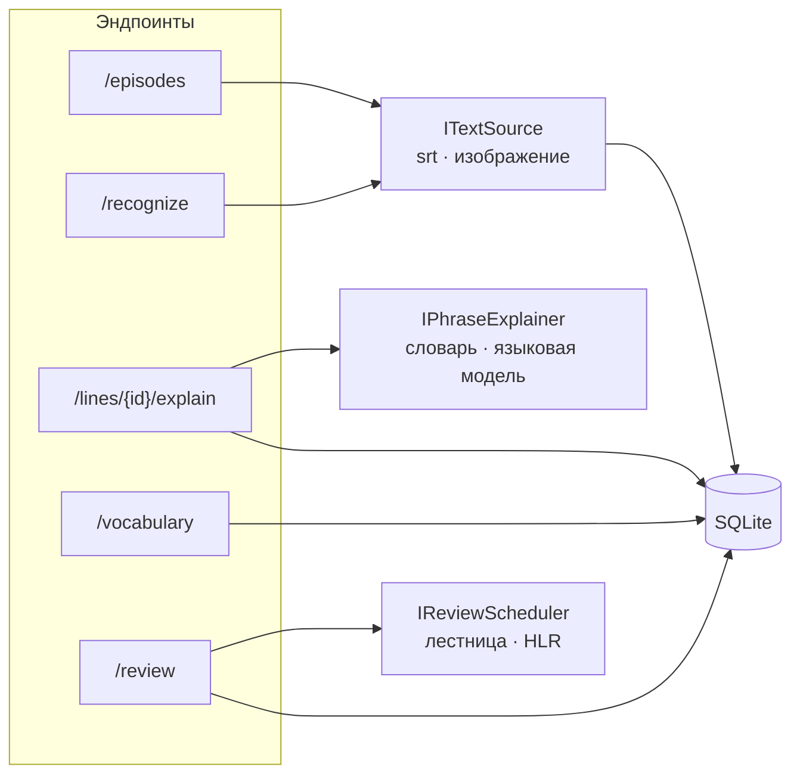
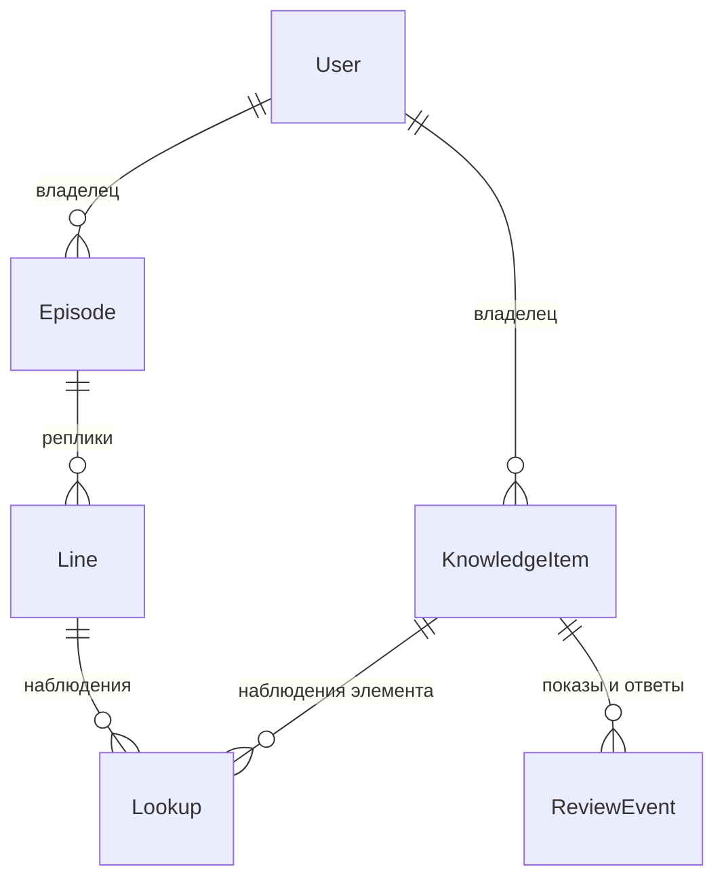

# 2. Проектирование

Подробные версии: требования — [`docs/03-requirements.md`](../03-requirements.md),
архитектура — [`docs/04-architecture.md`](../04-architecture.md), размещение
распознавания — [`docs/05-ocr-placement.md`](../05-ocr-placement.md),
решения и альтернативы — [`docs/guide.md`](../guide.md), раздел 3.

## 2.1. Требования

Функциональные требования (полный список — 24 пункта в `docs/03-requirements.md`):

- загрузка субтитров `.srt` и разбор на реплики с таймингами;
- распознавание текста со снимка экрана, и распознанный текст идёт в тот же
  поток, что и субтитры;
- объяснение фразы в контексте: название произведения, говорящий, две
  реплики до и две после; при неполном контексте — по тому, что есть;
- словарь по умолчанию работает без ключей, языковая модель включается
  настройкой;
- личный словарь, показ на повторение, ответ «помнил / не помнил» и
  пересчёт интервала;
- полная история показов и ответов, без удаления и агрегирования;
- пользователи, разделение данных, лимиты на дорогие запросы.

Нефункциональные: .NET 10, ASP.NET Core minimal API, SQLite и EF Core с
миграциями, запуск с чистого клона одной командой, работа без внешних
сервисов, автотесты, CI, монолит без микросервисов ([`SPEC.md`](../../SPEC.md)).

## 2.2. Архитектура

Монолит с папками по сценариям. Ключевой приём — интерфейс и несколько
реализаций, выбор в конфигурации. Он повторяется три раза и даёт сразу
плавную деградацию, подмену в тестах и эксперимент.

## 2.3. Модель данных

Главное решение: **фраза — единица показа, слово или выражение — единица
учёта**. Наблюдение (`Lookup`: что посмотрели и в какой реплике) хранится
отдельно от элемента знания (`KnowledgeItem`: что отслеживаем и когда
показать). История (`ReviewEvent`) только дописывается.

Почему так:

- одну фразу смотрят в разных сценах — нужны все контексты, а не последний;
- обучаемая модель забывания пересчитывает веса по всей истории ответов,
  поэтому сырые события нельзя сводить к счётчикам ([`Review/AdaptiveScheduler.cs`](../../Review/AdaptiveScheduler.cs));
- связь наблюдения с элементом — внешним ключом, а не по строке: иначе смена
  правила нормализации оторвала бы старые наблюдения от элементов.

Данные разделены по пользователям глобальными фильтрами EF Core
([`Data/AppDbContext.cs`](../../Data/AppDbContext.cs)): условие на владельца
добавляется к каждому запросу само, его нельзя забыть.

## 2.4. Размещение распознавания текста

Рассмотрены три варианта: распознавание на клиенте, на сервере и гибрид
(подробно — `docs/05-ocr-placement.md`). Выбран сервер:

- логика остаётся в бэкенде, клиент тонкий;
- распознавание проверяется тестами и в CI, в одной версии движка;
- эксперимент воспроизводим: один движок для всех.

Цена — передача изображения и нагрузка на сервер. Для развития предложен
гибрид: Windows OCR на клиенте и сервер при низкой уверенности. Задержка и
объём трафика для вариантов не измерялись: `[ЗАМЕР]`.

## 2.5. Обработка ошибок

Ожидаемые сбои окружения (словарь или модель недоступны, нет Tesseract,
квота исчерпана) — свои исключения, которые один обработчик переводит в
503, 422 или 429 в формате ProblemDetails
([`Infrastructure/KnownExceptionHandler.cs`](../../Infrastructure/KnownExceptionHandler.cs)).
Ошибки бизнес-логики («уже отвечено», «неверный пароль») — значения
результата, а не исключения. Ошибка в коде — 500.
