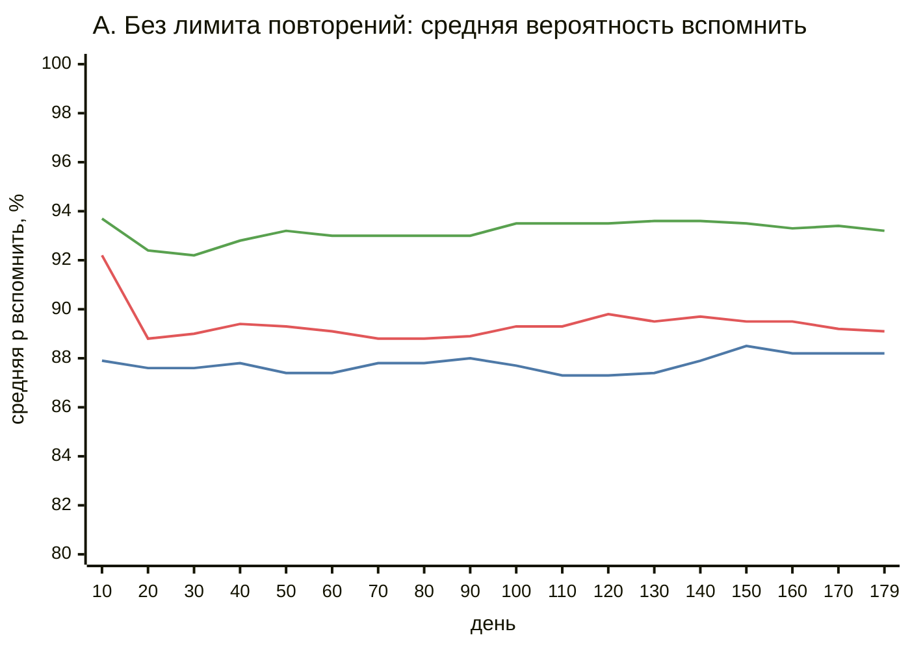
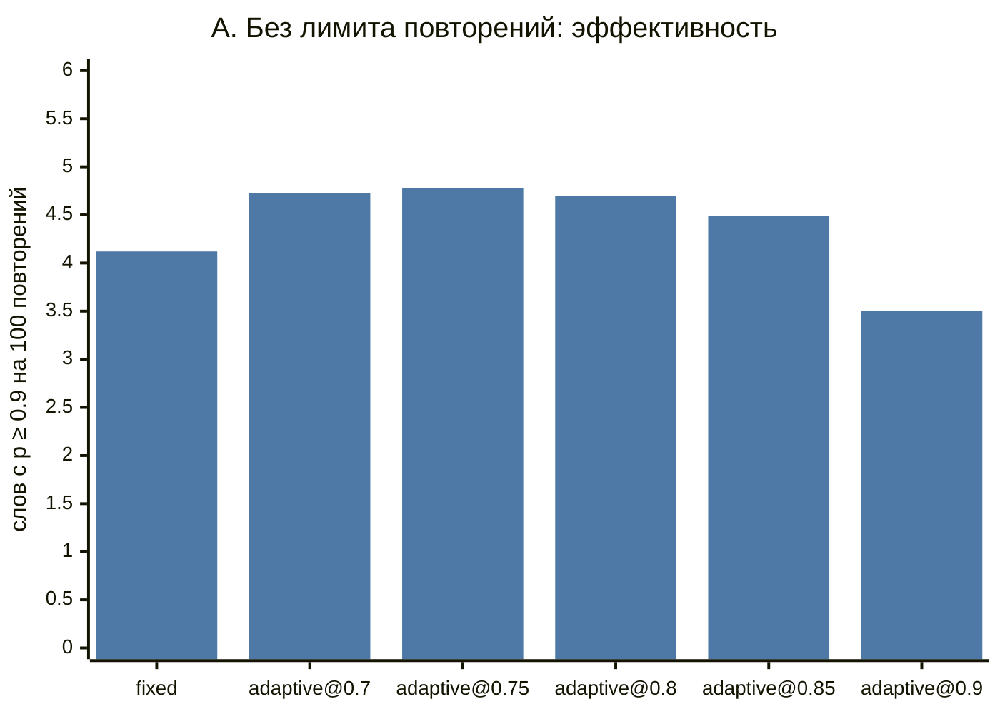
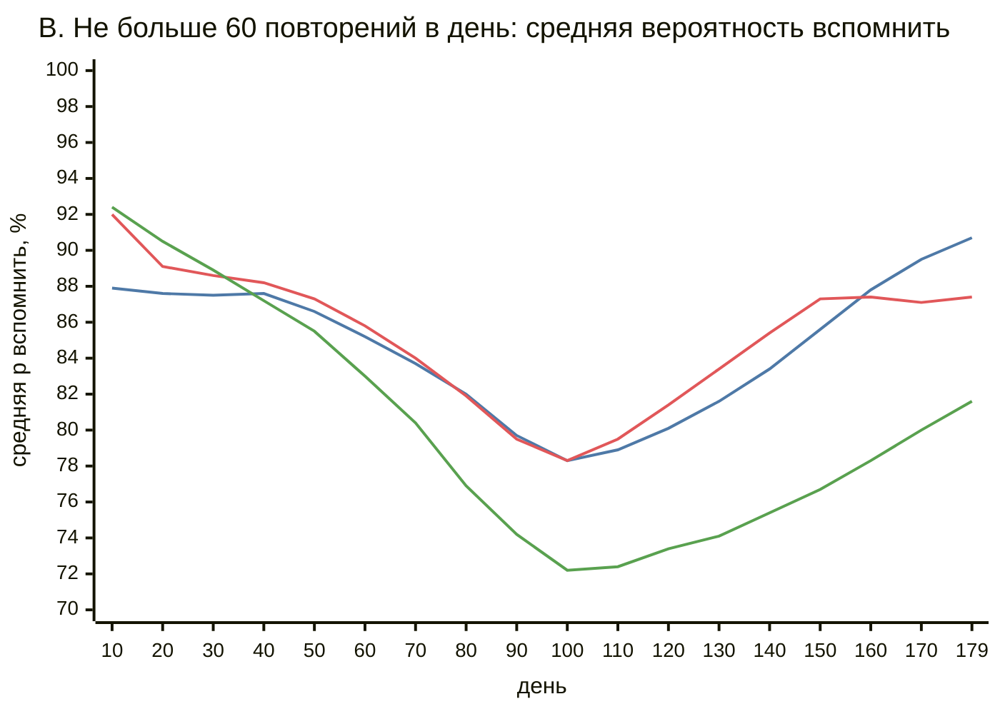
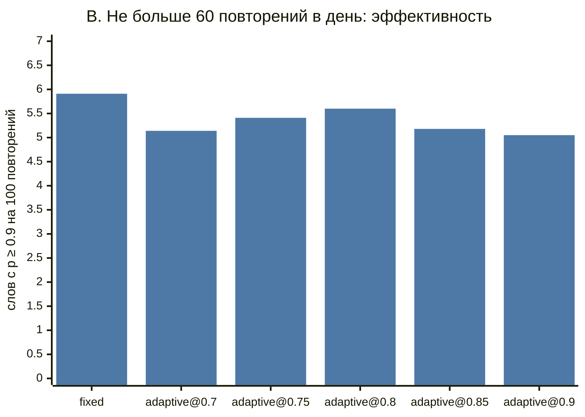

# Фиксированные интервалы против адаптивного планировщика: симуляция

## Коротко

- **Без лимита на число повторений адаптивный планировщик лучше.** При той же нагрузке
  (`adaptive@0.75`: 10 932 повторения против 10 837 у `fixed`) к 180-му дню ученик уверенно
  (p ≥ 0.9) помнит 522 слова против 447, то есть на 17 % больше. Так вышло во всех 10 прогонах из 10.
- **Целевая вероятность вспомнить управляет компромиссом между нагрузкой и удержанием.** При цели 0.9
  удержание растёт до 95 %, но повторений в 2,2 раза больше. Больше всего слов на одно повторение
  дают цели 0.75–0.8.
- **Модель забывания откалибрована в среднем.** Доля верных ответов почти совпадает с целью
  (77 % при цели 0.75, 85 % при 0.85, 90 % при 0.9), хотя форма модели не совпадает с «истинной» памятью ученика.
- **При жёстком лимите в 60 повторений в день преимущество пропадает.** Фиксированный планировщик
  не хуже или лучше любого адаптивного, а адаптивный с высокой целью копит очередь просроченных слов.
  Адаптивному планировщику нужен приоритет очереди по вероятности забывания, а не по дате.

- **Очередь по вероятности забыть возвращает преимущество при лимите.** С ней `adaptive@0.8` в сценарии B
  даёт 656 уверенно помнимых слов против 589 с очередью по дате и 593 у `fixed`; при цели 0.7 пользы нет.
- **Планировщик основного приложения принимает те же решения.** Адаптивный планировщик перенесён
  в C# (`Review/AdaptiveScheduler.cs`) и прогнан в этой же симуляции: в 150 прогонах из 150
  (включая очередь по вероятности забыть) все 1 887 610 решений и все прогнозы вероятности забыть
  совпали с Python. Поэтому выводы
  ниже относятся и к нему (раздел «Проверка C#-планировщика основного приложения»).

- **На реальных людях модель забывания откалибрована плохо.** На данных Duolingo (12,9 млн сессий)
  она почти всегда обещает вспомнить с вероятностью около 0.98, а фактическая доля верных — 0.905. Различает
  она слабо: AUC 0.538 против 0.590 у логистической регрессии на тех же признаках. Вывод «откалибрована
  в среднем» верен только для синтетического ученика (раздел «Проверка на реальных людях: Duolingo»).

Все числа ниже, кроме раздела про Duolingo, — результат синтетической симуляции с параметрами,
подобранными вручную. Это проверка механики, а не измерение на людях (см. «Ограничения»).

## Что сравниваем

Оба планировщика отвечают на один вопрос: через сколько дней показать слово снова,
если известна история ответов «помнил / не помнил» (`ReviewEvent` из `SPEC.md`).

**`fixed`: базовая линия.** Лестница интервалов 1, 3, 7, 14, 30, 60, 120 дней. Верный ответ
поднимает слово на ступень выше, ошибка возвращает на первую. Такие лестницы стоят в простых
приложениях с карточками.

**`adaptive@T`: half-life regression** (Settles & Meeder, 2016, модель Duolingo).
Вероятность вспомнить слово через `t` дней:

```
p = 2^(−t / h),    h = 2^(θ · x)
x = [1, √(верных ответов), √(ошибок), последний ответ был ошибкой]
```

`h` — период полураспада памяти в днях, вероятность забывания равна `1 − p`. Веса `θ` общие
для всех слов. Планировщик подбирает их онлайн-градиентным спуском по `(p − y)²` после каждого ответа
и стартует с `θ = 0`, то есть с `h = 1` дня. Следующий показ назначается на момент, когда
предсказанная `p` падает до цели `T`: `t = h · log2(1/T)`. Интервал от 1 до 365 дней.

Код: `srs_sim/schedulers.py`.

## Синтетический ученик

Скрытая «истинная» память устроена по мотивам модели DSR (difficulty / stability / retrievability),
на которой построен FSRS (`srs_sim/learner.py`):

- у каждого слова своя сложность `D ∈ [1, 10]` (Beta(2, 2), растянутое на отрезок), планировщики её не видят;
- стабильность `S` — число дней, за которое вероятность вспомнить падает до 90 %: `R = 0.9^(t/S)`;
- начальная `S` около 1,5 дня, у трудных слов меньше;
- при верном ответе `S` растёт, и тем сильнее, чем ниже было `R` в момент показа (эффект интервалов);
  у трудных и уже стабильных слов рост слабее;
- ошибка умножает `S` на 0.3;
- 2 % «случайных ошибок» даже при живой памяти.

Форма модели специально отличается от модели адаптивного планировщика: другое основание экспоненты,
другие признаки, есть скрытая сложность. Иначе адаптивный планировщик получил бы правильную модель даром.
Параметры ученика были выбраны до первых сравнений и под результат не подгонялись.

## Протокол

- 180 дней. Первые 90 дней ученик каждый день встречает в игре 10 новых слов, всего 900.
  Знакомство не считается повторением.
- Каждый день сначала замеряется средняя истинная `R` по всем словам, потом идут повторения,
  потом появляются новые слова.
- Очередь дня — все слова со сроком ≤ сегодня, сначала самые просроченные. В сценарии B берутся
  только первые 60, остальные ждут следующего дня. Порядок одинаков для обоих планировщиков.
- 10 прогонов (seed'ы 2026–2035), на каждый прогон новый экземпляр планировщика: адаптивный
  не переносит выученные веса между учениками.
- Сравнение парное: при одном seed у обоих планировщиков одни и те же 900 слов с одинаковой сложностью
  (генераторы сложности и ответов независимы).

Метрики:

| Метрика | Что значит |
|---|---|
| Повторений всего | нагрузка на ученика за 180 дней |
| Доля верных ответов | сколько показов закончились «помнил» |
| Средняя вероятность вспомнить в конце | средняя истинная `R` по всем 900 словам на 180-й день |
| Слов с p ≥ 0.9 в конце | сколько слов ученик уверенно помнит в конце |
| Таких слов на 100 повторений | эффективность: польза на единицу нагрузки |
| Просрочено в конце | слова, до которых не дошла очередь из-за лимита |
| Brier score | средний `(p̂ − y)²` прогнозов адаптивного планировщика, меньше — лучше; у `fixed` прогнозов нет |
| Seed'ов, где лучше `fixed` | в скольких из 10 парных прогонов слов с p ≥ 0.9 строго больше |

## Результаты

<!-- AUTO:BEGIN — генерируется `python -m srs_sim`, не править руками -->

Seed'ы: 2026…2035 (10 прогонов на каждую строку), 180 дней, новые слова первые 90 дней по 10 в день (всего 900). Значения — среднее ± стандартное отклонение по прогонам.

### A. Без лимита повторений

| Планировщик | Повторений всего | Доля верных ответов, % | Средняя вероятность вспомнить в конце, % | Слов с p ≥ 0.9 в конце | Таких слов на 100 повторений | Просрочено в конце | Brier score | Seed'ов, где слов с p ≥ 0.9 больше, чем у fixed |
|---|---:|---:|---:|---:|---:|---:|---:|---:|
| `fixed` | 10837 ± 148 | 78.0 ± 0.4 | 88.2 ± 0.3 | 447 ± 13 | 4.12 ± 0.15 | 0 ± 0 | — | — |
| `adaptive@0.7` | 9766 ± 291 | 73.1 ± 0.3 | 87.1 ± 0.5 | 461 ± 21 | 4.73 ± 0.27 | 0 ± 0 | 0.197 ± 0.001 | 8/10 |
| `adaptive@0.75` | 10932 ± 278 | 77.1 ± 0.3 | 89.0 ± 0.5 | 522 ± 24 | 4.78 ± 0.19 | 0 ± 0 | 0.177 ± 0.002 | 10/10 |
| `adaptive@0.8` | 13053 ± 459 | 81.4 ± 0.2 | 91.1 ± 0.4 | 612 ± 23 | 4.70 ± 0.28 | 0 ± 0 | 0.152 ± 0.001 | 10/10 |
| `adaptive@0.85` | 16212 ± 591 | 85.3 ± 0.2 | 93.2 ± 0.3 | 726 ± 17 | 4.49 ± 0.17 | 0 ± 0 | 0.126 ± 0.001 | 10/10 |
| `adaptive@0.9` | 23665 ± 978 | 89.7 ± 0.2 | 95.4 ± 0.3 | 827 ± 9 | 3.50 ± 0.16 | 0 ± 0 | 0.093 ± 0.001 | 10/10 |



Линии (mermaid не рисует легенду): #4e79a7 — `fixed`, #e15759 — `adaptive@0.75`, #59a14f — `adaptive@0.85`.



### B. Не больше 60 повторений в день

| Планировщик | Повторений всего | Доля верных ответов, % | Средняя вероятность вспомнить в конце, % | Слов с p ≥ 0.9 в конце | Таких слов на 100 повторений | Просрочено в конце | Brier score | Seed'ов, где слов с p ≥ 0.9 больше, чем у fixed |
|---|---:|---:|---:|---:|---:|---:|---:|---:|
| `fixed` | 10029 ± 69 | 64.1 ± 2.4 | 90.7 ± 0.5 | 593 ± 14 | 5.91 ± 0.11 | 36 ± 36 | — | — |
| `adaptive@0.7` | 9354 ± 184 | 65.0 ± 2.3 | 86.0 ± 0.7 | 481 ± 20 | 5.14 ± 0.22 | 0 ± 0 | 0.203 ± 0.001 | 0/10 |
| `adaptive@0.75` | 10015 ± 137 | 64.3 ± 2.3 | 87.5 ± 1.1 | 542 ± 42 | 5.41 ± 0.39 | 0 ± 0 | 0.187 ± 0.002 | 1/10 |
| `adaptive@0.8` | 10510 ± 45 | 60.7 ± 2.4 | 88.7 ± 1.0 | 589 ± 29 | 5.60 ± 0.28 | 54 ± 49 | 0.170 ± 0.004 | 4/10 |
| `adaptive@0.85` | 10589 ± 2 | 57.2 ± 2.3 | 81.7 ± 3.2 | 548 ± 39 | 5.18 ± 0.37 | 284 ± 47 | 0.146 ± 0.004 | 1/10 |
| `adaptive@0.9` | 10590 ± 0 | 56.6 ± 1.4 | 74.8 ± 1.5 | 535 ± 17 | 5.05 ± 0.16 | 418 ± 24 | 0.128 ± 0.003 | 0/10 |



Линии (mermaid не рисует легенду): #4e79a7 — `fixed`, #e15759 — `adaptive@0.75`, #59a14f — `adaptive@0.85`.



<!-- AUTO:END -->

## Вывод

**Сценарий A (без лимита).** Адаптивный планировщик выигрывает у фиксированной лестницы при любой
нагрузке, которую можно сравнить:

- при равной нагрузке (`adaptive@0.75`, +0,9 % повторений) слов с p ≥ 0.9 на 17 % больше (522 против 447),
  средняя вероятность вспомнить 89,0 % против 88,2 %, преимущество в 10 прогонах из 10;
- при меньшей нагрузке (`adaptive@0.7`, на 10 % меньше повторений) уверенно помнимых слов всё ещё
  чуть больше (461 против 447, 8 из 10 прогонов), хотя средняя `R` немного ниже (87,1 % против 88,2 %);
- эффективность (слов на 100 повторений) у адаптивного 4,5–4,8 при целях 0.7–0.85 против 4,1 у `fixed`.
  При цели 0.9 эффективность падает до 3,5: последние проценты удержания стоят дорого.

Выигрыш объясняется тем, что лестница одинакова для всех слов. Лёгкие слова она показывает слишком
часто, а трудные после ошибки снова проходят всю лестницу с первой ступени. Адаптивная модель
через признак «число ошибок» растягивает интервалы лёгких слов и сжимает интервалы трудных.

Модель вероятности забывания полезна и сама по себе: доля верных ответов отличается от цели
на 0,3–3 п.п., хотя модель задана неверно (HLR против DSR). Отклонение всегда в плюс и больше
при низких целях. Причину отдельно не исследовал. Возможные объяснения: округление интервалов
до целых дней и то, что онлайн-обучение отстаёт от растущей стабильности памяти. Значит, параметр `T` можно показывать
пользователю как понятную настройку: «хочу помнить 80 % слов при повторении».

**Сценарий B (не больше 60 повторений в день).** Здесь преимущество исчезает:

- `fixed` даёт больше всего слов с p ≥ 0.9 (593) и самую высокую среднюю `R` (90,7 %);
  `adaptive@0.8` догоняет его по числу слов (589, лучше в 4 из 10 прогонов), остальные цели хуже;
- при целях 0.85 и 0.9 адаптивный планировщик просит больше повторений, чем позволяет лимит,
  и к концу у него 284–418 просроченных слов.

Причина в том, что адаптивный планировщик не знает про лимит. Очередь отсортирована по дате, поэтому
лимит тратится на самые просроченные слова, которые ученик уже забыл. Выводы для основного приложения (V4):

1. если лимита на повторения нет, адаптивный планировщик с целью около 0.8 — разумный выбор по умолчанию
   (так и сделано: в приложении `Review:Adaptive:TargetRetention = 0.8`, дневного лимита нет);
2. если лимит появится, очередь нужно сортировать по предсказанной вероятности забывания или по
   ожидаемой пользе от показа, а цель `T` подбирать под лимит. Без этого фиксированная лестница надёжнее.
   (Первая часть проверена позже — раздел «Очередь по вероятности забыть»: при целях 0.8–0.9 помогает.)

Ещё одно наблюдение: у `fixed` средняя `R` в сценарии B выше, чем в A (90,7 % против 88,2 %), хотя
повторений меньше. Лимит вынужденно удлиняет интервалы, а синтетический ученик сильно вознаграждает
поздние успешные повторения. Это говорит скорее о модели ученика (см. ограничение 2) и о том, что
лестница 1–3–7… для такого ученика слишком частая, чем о пользе лимитов.

## Ограничения симуляции

1. **Ученик синтетический.** Параметры памяти выбраны вручную, а не обучены на реальных ответах.
   Все выводы верны для этой модели. На живых людях выигрыш может оказаться другим и по величине, и по знаку.
2. **Анализа чувствительности нет.** Проверены только два режима лимита. От силы эффекта интервалов
   (`spacing_effect`), штрафа за ошибку и распределения сложности результат может зависеть, особенно в сценарии B.
3. **Модели родственные.** И «истинная» память, и HLR — экспоненциальное забывание со стабильностью,
   которая растёт при успехе. У настоящей памяти отличий от HLR, скорее всего, больше, поэтому
   хорошая калибровка здесь — оптимистичная оценка.
4. **Слова независимы.** Нет интерференции похожих слов и нет встреч со словом вне повторений.
   А в игре пользователь как раз встречает слова снова, и это укрепляет память без всякого планировщика.
5. **Ученик идеален.** Он приходит каждый день, не устаёт, отвечает честно. В приложении «помнил /
   не помнил» — самооценка, она шумная и смещённая.
6. **Адаптивная модель минимальна.** Веса общие для всех слов, признаков слова (длина, частотность,
   часть речи) нет, холодный старт с `h = 1` дня, нет переноса между пользователями.
   Более богатая модель может выиграть больше, но и переобучиться на коротких историях.
7. **Базовая линия не настраивалась.** Лестница 1–3–7–14–30–60–120 — одна разумная из многих.
   Другая лестница (например, с более длинными шагами) могла бы сократить разрыв в сценарии A.
8. **Метрики меряют скрытую `R`.** В реальности её не видно, остаётся только доля верных ответов. Замер
   в один день (180-й) зависит ещё и от того, на какой фазе расписания оказалось каждое слово.
9. **Время дискретное.** Интервалы округляются до целых дней, адаптивный не может назначить меньше дня.
10. **Воспроизводимость привязана к версии Python.** Числа получены на Python 3.13. Модуль `random`
    гарантирует одинаковые `random()` при одинаковом seed, но не обещает неизменности
    `betavariate` между версиями. На другой версии числа могут чуть отличаться, выводы не должны.

## Очередь по вероятности забыть

В сценарии B адаптивный планировщик проигрывал лестнице. Гипотеза из «Вывода»: виновата очередь
по дате — лимит тратится на самые просроченные слова. Проверка: тот же эксперимент, но очередь дня
у адаптивного планировщика отсортирована по предсказанной вероятности забыть, сначала самые
рискованные (`SimConfig.queue_order = "forgetting"`, `srs_sim/simulation.py::order_queue`).
Очередь сортируется один раз в начале дня, при равенстве — по дате и id. У `fixed` прогнозов нет,
его очередь осталась по дате. Ученик, seed'ы и сценарии те же; сравнение парное.

<!-- QUEUE:BEGIN — генерируется `python -m srs_sim.queue_experiment`, не править руками -->

Seed'ы: 2026…2035 (10 парных прогонов на строку). «дата» — очередь по сроку, «p забыть» — по предсказанной вероятности забыть. Значения — среднее по прогонам.

#### A. Без лимита повторений

`fixed` (очередь по дате): слов с p ≥ 0.9 — 447, средняя R в конце — 88.2 %, просрочено в конце — 0.

| Цель T | Слов с p ≥ 0.9: дата → p забыть | Seed'ов, где p забыть лучше даты | Средняя R в конце, %: дата → p забыть | Просрочено в конце: дата → p забыть | Повторений: дата → p забыть | Seed'ов, где p забыть лучше fixed |
|---|---:|---:|---:|---:|---:|---:|
| 0.7 | 461 → 468 | 5/10 | 87.1 → 87.3 | 0 → 0 | 9766 → 9843 | 8/10 |
| 0.75 | 522 → 536 | 7/10 | 89.0 → 89.2 | 0 → 0 | 10932 → 11009 | 10/10 |
| 0.8 | 612 → 619 | 7/10 | 91.1 → 91.2 | 0 → 0 | 13053 → 12940 | 10/10 |
| 0.85 | 726 → 726 | 6/10 | 93.2 → 93.3 | 0 → 0 | 16212 → 16241 | 10/10 |
| 0.9 | 827 → 834 | 8/10 | 95.4 → 95.5 | 0 → 0 | 23665 → 23634 | 10/10 |

#### B. Не больше 60 повторений в день

`fixed` (очередь по дате): слов с p ≥ 0.9 — 593, средняя R в конце — 90.7 %, просрочено в конце — 36.

| Цель T | Слов с p ≥ 0.9: дата → p забыть | Seed'ов, где p забыть лучше даты | Средняя R в конце, %: дата → p забыть | Просрочено в конце: дата → p забыть | Повторений: дата → p забыть | Seed'ов, где p забыть лучше fixed |
|---|---:|---:|---:|---:|---:|---:|
| 0.7 | 481 → 478 | 4/10 | 86.0 → 86.6 | 0 → 0 | 9354 → 9266 | 0/10 |
| 0.75 | 542 → 565 | 7/10 | 87.5 → 88.8 | 0 → 0 | 10015 → 9789 | 1/10 |
| 0.8 | 589 → 656 | 9/10 | 88.7 → 90.8 | 54 → 1 | 10510 → 10343 | 10/10 |
| 0.85 | 548 → 724 | 10/10 | 81.7 → 92.6 | 284 → 80 | 10589 → 10586 | 10/10 |
| 0.9 | 535 → 725 | 10/10 | 74.8 → 92.5 | 418 → 332 | 10590 → 10590 | 10/10 |

<!-- QUEUE:END -->

**Гипотеза подтвердилась для целей 0.8–0.9 при лимите и не подтвердилась для 0.7.**

- Сценарий B: при T = 0.8 слов с p ≥ 0.9 стало 656 вместо 589 (лучше даты в 9 прогонах из 10)
  и больше, чем у `fixed` (593), во всех 10 прогонах. При T = 0.85 и 0.9 выигрыш сильнее
  (548 → 724 и 535 → 725, 10 из 10), очередь просроченных слов в конце меньше, но при 0.9 всё ещё 332.
  При T = 0.7 пользы нет: 481 → 478, лучше даты только в 4 прогонах из 10, `fixed` по-прежнему лучше.
- Сценарий A (без лимита) — контроль: все слова со сроком всё равно повторяются в тот же день, меняется
  только порядок обучения модели внутри дня. Разница небольшая (при T = 0.8 — 612 → 619 слов,
  лучше в 7 из 10) и при T = 0.85 нулевая по среднему. Вреда нет, но и заметной пользы тоже.

Почему так: при высокой цели адаптивный планировщик назначает больше повторений, чем позволяет лимит.
По дате очередь отдаёт лимит самым старым срокам; по вероятности — тем словам, которые модель считает
самыми рискованными, а это не всегда самые просроченные (у лёгких слов долгий срок, но низкий риск).
Ограничения те же, что у всей симуляции; отдельно: порядок проверен только с дневным лимитом 60,
а ученик всегда приходит каждый день.

## Проверка C#-планировщика основного приложения

Модель из `srs_sim/schedulers.py` перенесена в приложение: `Review/HalfLifeRegression.cs`
и `Review/AdaptiveScheduler.cs`. Здесь проверено, что перенесённый код **на тех же условиях
принимает те же решения**, что и Python-версия, по которой написан этот отчёт.

### Что именно проверено

1. **Тот же код, что в приложении.** Решения принимает класс `EasyLangApi.Review.AdaptiveScheduler`
   из основного проекта, а не копия. Его вызывает консольный мост `bridge/` через тот же интерфейс,
   что и `ReviewService`: `Schedule(элемент, история элемента, все ответы пользователя, сейчас)`
   и `ForgettingProbability(...)`, а для очереди по вероятности забыть — `CreateEstimator(...)`, как
   `ReviewService` при `Review:QueueOrder = ForgettingProbability`. Веса модели, как и в приложении,
   обучаются заново по всем ответам при каждом решении.
2. **Те же условия.** Симуляция — `srs_sim.simulation.simulate` без изменений: тот же синтетический
   ученик, seed'ы 2026–2035, сценарии A и B и сценарий B с очередью по вероятности забыть (раздел выше),
   цели 0.7–0.9. Порядок очереди в третьем сценарии считает C# — тем же оценщиком, что приложение. Python-планировщик
   и C#-планировщик получают одинаковые последовательности ответов, пока их решения совпадают.
3. **Что сравнивалось** (`srs_sim/csharp_check.py`), для каждого из 150 прогонов:
   - каждое решение об интервале (вся последовательность, включая первые показы новых слов);
   - каждый прогноз вероятности забыть перед ответом — на точное равенство чисел double;
   - итоговые метрики прогона и их ряды по дням.
4. **Отдельно, без Python** — C#-тесты в `tests/EasyLangApi.Tests` (идут в CI):
   веса и периоды полураспада на явной последовательности и 1333 решения детерминированного
   сценария (`srs_sim/golden.py` → `Assets/hlr-golden.json`) сверяются с Python без допуска.

Результат (генерируется `python -m srs_sim.csharp_check`):

<!-- CSHARP:BEGIN — генерируется `python -m srs_sim.csharp_check`, не править руками -->

Seed'ы: 2026…2035 (10 прогонов на строку), 180 дней, новые слова первые 90 дней по 10 в день. Всего прогонов C#-планировщика: 150, решений: 1887610.

#### A. Без лимита повторений

| Цель T | Решения совпали | Прогнозы p забыть совпали | Метрики прогона совпали | Повторений, Python / C# | Слов с p ≥ 0.9, Python / C# | Brier, Python / C# |
|---|---:|---:|---:|---:|---:|---:|
| 0.7 | 10/10 | 10/10 | 10/10 | 9766 / 9766 | 461 / 461 | 0.197 / 0.197 |
| 0.75 | 10/10 | 10/10 | 10/10 | 10932 / 10932 | 522 / 522 | 0.177 / 0.177 |
| 0.8 | 10/10 | 10/10 | 10/10 | 13053 / 13053 | 612 / 612 | 0.152 / 0.152 |
| 0.85 | 10/10 | 10/10 | 10/10 | 16212 / 16212 | 726 / 726 | 0.126 / 0.126 |
| 0.9 | 10/10 | 10/10 | 10/10 | 23665 / 23665 | 827 / 827 | 0.093 / 0.093 |

#### B. Не больше 60 повторений в день

| Цель T | Решения совпали | Прогнозы p забыть совпали | Метрики прогона совпали | Повторений, Python / C# | Слов с p ≥ 0.9, Python / C# | Brier, Python / C# |
|---|---:|---:|---:|---:|---:|---:|
| 0.7 | 10/10 | 10/10 | 10/10 | 9354 / 9354 | 481 / 481 | 0.203 / 0.203 |
| 0.75 | 10/10 | 10/10 | 10/10 | 10015 / 10015 | 542 / 542 | 0.187 / 0.187 |
| 0.8 | 10/10 | 10/10 | 10/10 | 10510 / 10510 | 589 / 589 | 0.170 / 0.170 |
| 0.85 | 10/10 | 10/10 | 10/10 | 10589 / 10589 | 548 / 548 | 0.146 / 0.146 |
| 0.9 | 10/10 | 10/10 | 10/10 | 10590 / 10590 | 535 / 535 | 0.128 / 0.128 |

#### B. Не больше 60 повторений в день, очередь по вероятности забыть

| Цель T | Решения совпали | Прогнозы p забыть совпали | Метрики прогона совпали | Повторений, Python / C# | Слов с p ≥ 0.9, Python / C# | Brier, Python / C# |
|---|---:|---:|---:|---:|---:|---:|
| 0.7 | 10/10 | 10/10 | 10/10 | 9266 / 9266 | 478 / 478 | 0.210 / 0.210 |
| 0.75 | 10/10 | 10/10 | 10/10 | 9789 / 9789 | 565 / 565 | 0.200 / 0.200 |
| 0.8 | 10/10 | 10/10 | 10/10 | 10343 / 10343 | 656 / 656 | 0.195 / 0.195 |
| 0.85 | 10/10 | 10/10 | 10/10 | 10586 / 10586 | 724 / 724 | 0.191 / 0.191 |
| 0.9 | 10/10 | 10/10 | 10/10 | 10590 / 10590 | 725 / 725 | 0.190 / 0.190 |

Расхождений нет: все решения и все прогнозы C#-планировщика совпали с Python. Brier score совпал точно.

<!-- CSHARP:END -->

Раз решения совпадают во всех прогонах, таблицы раздела «Результаты» и выводы из них относятся
к планировщику приложения в той же мере, что и к Python-версии.

### Что понадобилось для совпадения

Сначала C#-порт расходился с Python в последнем бите вероятности: Python 3.12+ складывает float
в `sum()` с компенсацией ошибок округления (алгоритм Неймайера), а C# — наивно. На детерминированном
сценарии первое расхождение появлялось на 58-м шаге, дальше оно могло менять решения. В C# скалярное
произведение `θ · x` теперь считается так же, как `sum()` в Python (`HalfLifeRegression.DotProduct`).
На Python 3.11 и более ранних версиях `sum()` наивный, и отчёт, полученный на нём, мог бы слегка отличаться.

### Что не проверено

1. **Путь через HTTP и базу.** Мост передаёт планировщику историю напрямую. Что `ReviewService`
   загружает из SQLite именно ответы текущего пользователя и добавляет только что данный ответ,
   проверено отдельными API-тестами приложения, но не в этой симуляции.
2. **Протокол приложения отличается от протокола симуляции.** В приложении новое слово доступно
   для повторения сразу после разбора, а в симуляции — через интервал нового элемента (1 день).
   В приложении время непрерывное, показ и ответ разнесены во времени, повторения идут по одному
   по запросу пользователя, дневного лимита нет. Цель по умолчанию в приложении — 0.8.
3. **Платформа.** Совпадение бит в бит получено на Linux x64 (.NET 10.0.14, glibc, Python 3.13).
   `Math.Pow` и `Math.Log2` в .NET на Linux вызывают те же функции libm, что и Python. На Windows
   и macOS реализации могут отличаться в последнем бите; там совпадение не проверялось.
4. **Польза на людях.** Совпадение с Python говорит о правильности переноса, а не о качестве
   модели: все ограничения симуляции из раздела выше остаются в силе.

## Проверка на реальных людях: Duolingo

Главная оговорка симуляции — ученик искусственный. Поэтому модель забывания нашего планировщика
проверена на реальных ответах людей.

**Данные:** B. Settles, B. Meeder. *A Trainable Spaced Repetition Model for Language Learning*, ACL 2016.
Файл `settles.acl16.learning_traces.13m.csv.gz` (Harvard Dataverse, datafile 3091087), лицензия CC BY-NC 4.0.
Данные скачивались на раннере GitHub Actions (workflow `srs-real`, ветка `run/srs`), в репозиторий не попадали.
Ниже только наши агрегаты. Полные таблицы — в ветке `results`, папка `results/srs/`
(`results.md`, `metrics.json`, `environment.txt`; прогон 41859080470, коммит 5d4cb05, sha256 файла `26cf9b33…`).

**Что сделано** (`srs_sim/duolingo.py`):
- Каждая строка — сессия: человек `session_seen` раз повторял слово и `session_correct` раз ответил верно;
  до неё известны `history_seen`, `history_correct` и `delta`, время с прошлого показа.
- **Модель — ровно та же, что в `AdaptiveScheduler`:** те же признаки (√верных, √ошибок,
  «последний раз ошибка»), онлайн-спуск с тем же шагом и старт с θ = 0. Совпадение весов с
  `AdaptiveScheduler.observe` проверяет тест. Отличие одно: цель — доля верных в сессии, а не 0/1.
- **Разбиение по времени:** обучение на первых 80 % строк по `timestamp` (10,3 млн, до 2013-03-10 05:04 UTC),
  проверка на последних 20 % (2,6 млн). Признаки строятся только по прошлому, веса на проверке заморожены.
  «Последний раз ошибка» берётся из прошлой сессии той же пары «человек — слово» в данных.
  Она есть у 1,54 млн из 2,57 млн строк проверки, у остальных признак равен 0.
- **Базовые линии:**
  - константа — средняя доля верных на обучении;
  - экспонента с одним периодом полураспада для всех;
  - логистическая регрессия на тех же признаках плюс log(1 + Δ), обученная точно, методом Ньютона.

| Модель | MAE ↓ | AUC ↑ | ECE ↓ | Среднее предсказание | Доля верных |
|---|---:|---:|---:|---:|---:|
| Константа | 0.1743 | 0.5000 | 0.0084 | 0.896 | 0.905 |
| Одна экспонента для всех | 0.1195 | 0.5334 | 0.0857 | 0.976 | 0.905 |
| Логистическая регрессия | 0.1712 | 0.5900 | 0.0113 | 0.894 | 0.905 |
| **Наш планировщик (HLR)** | **0.1139** | 0.5379 | 0.0880 | 0.984 | 0.905 |

- **MAE** — средняя |p̂ − доля верных в сессии|.
- **AUC** считается по отдельным ответам: строка даёт `session_correct` верных и
  `session_seen − session_correct` неверных ответов с одной оценкой p̂.
- **ECE** — средняя по ответам |p̂ − доля верных| в 10 корзинах по p̂.

Калибровка нашей модели на проверке:

| p̂ | Ответов | Среднее p̂ | Доля верных |
|---|---:|---:|---:|
| 0.0–0.5 | 13 613 | 0.33 | 0.86 |
| 0.5–0.8 | 60 142 | 0.70 | 0.87 |
| 0.8–0.9 | 95 473 | 0.86 | 0.88 |
| 0.9–1.0 | 4 540 445 | 0.993 | 0.906 |

Строки 0.0–0.5 и 0.5–0.8 объединены из корзин `results/srs/results.md` взвешиванием по числу ответов.

**Выводы:**

1. **Лучшее MAE не означает лучшую модель.** В большинстве сессий все ответы верные, и MAE награждает
   прогнозы около единицы. Наша модель почти всегда предсказывает около 0.99, поэтому выигрывает по MAE
   у константы, хотя хуже неё откалибрована (ECE 0.088 против 0.008).
2. **Модель плохо различает, кто вспомнит.** AUC 0.538 лишь немного выше, чем у одной экспоненты (0.533).
   Логистическая регрессия на тех же признаках даёт 0.590. Наши признаки в форме «экспонента от времени»
   используют историю слабее, чем простая логистическая модель.
3. **Модель не откалибрована.** Фактическая доля верных почти не зависит от прогноза: 0.84–0.93 во всех десяти исходных
   корзинах. Там, где модель обещает 0.33, люди отвечают верно в 86 % случаев. Поэтому вывод симуляции
   «доля верных держится у цели» **на реальных данных не подтвердился**.
4. **Что это значит для приложения.** Цель `T` нельзя показывать пользователю как
   «буду помнить T % слов»: на реальных людях это обещание не выполняется. Если модель обучать на
   ответах как есть, нужна калибровка или более гибкая модель. Логистическая регрессия здесь откалибрована
   почти как константа и при этом различает лучше.

**Ограничения этой проверки:**
- **Ответ в сессии Duolingo — не чистая проверка памяти.** Это упражнения с подсказками, часто через
  минуты после показа. Отсюда очень высокая доля верных при любых интервалах.
- **История `history_*` накоплена до начала выгрузки,** а «последний раз ошибка» известен только для пар,
  которые встретились в эти две недели.
- **Данные охватывают две недели 2013 года,** а проверка — последние два с половиной дня.
  Длинные интервалы в такой проверке почти не встречаются.
- **Модель общая для всех людей,** а в приложении веса учатся на ответах одного пользователя.
  Персональные веса здесь не проверялись.
- **Результаты статьи не сравнивались:** сама статья не открывалась. Метрики посчитаны по-своему (например,
  AUC по отдельным ответам) и с числами статьи напрямую несравнимы.
- **Полное повторение HLR из статьи не проверялось:** признаки слов и потеря по периоду полураспада
  здесь не использовались. Проверялась только модель нашего планировщика.

## Как воспроизвести

```bash
cd srs
python3 -m srs_sim            # ~30 секунд, перезаписывает блок «Результаты» в REPORT.md
python3 -m srs_sim.queue_experiment   # ~30 секунд, блок «Очередь по вероятности забыть»
python3 -m unittest discover -s tests -t .
python3 -m srs_sim.duolingo --data settles.acl16.learning_traces.13m.csv.gz --out out/duolingo   # ~6 минут, файл скачать отдельно
SRS_FULL=1 python3 -m unittest tests.test_reproducibility   # сверяет REPORT.md с новым прогоном

# проверка C#-планировщика приложения (нужен .NET 10 SDK):
python3 -m srs_sim.csharp_check                             # ~15 минут на 4 ядрах, перезаписывает блок C# выше
SRS_CSHARP=1 python3 -m unittest tests.test_csharp_bridge   # быстрая сверка, ~5 с
```

Только стандартная библиотека Python 3.11+, без внешних зависимостей (для проверки C# — ещё .NET 10 SDK). Seed'ы зафиксированы
в `srs_sim/experiment.py` (`SEED = 2026`, `N_RUNS = 10`).
