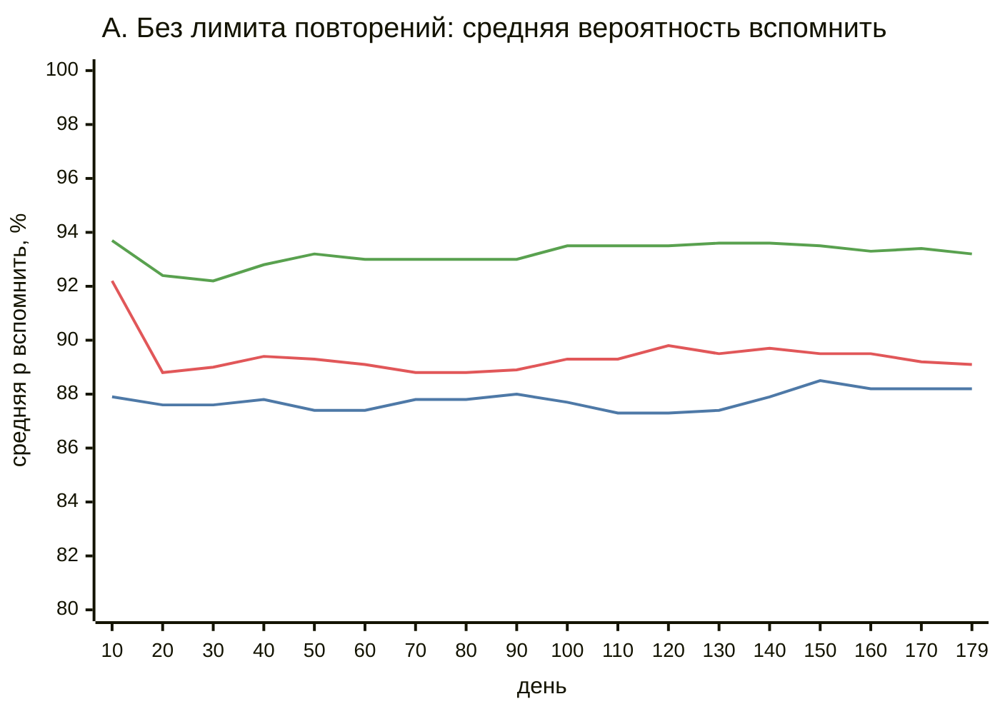
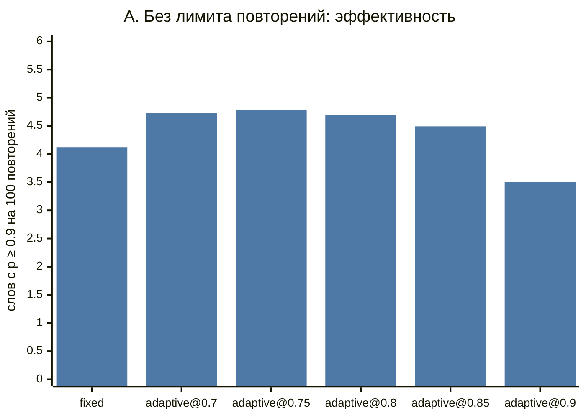
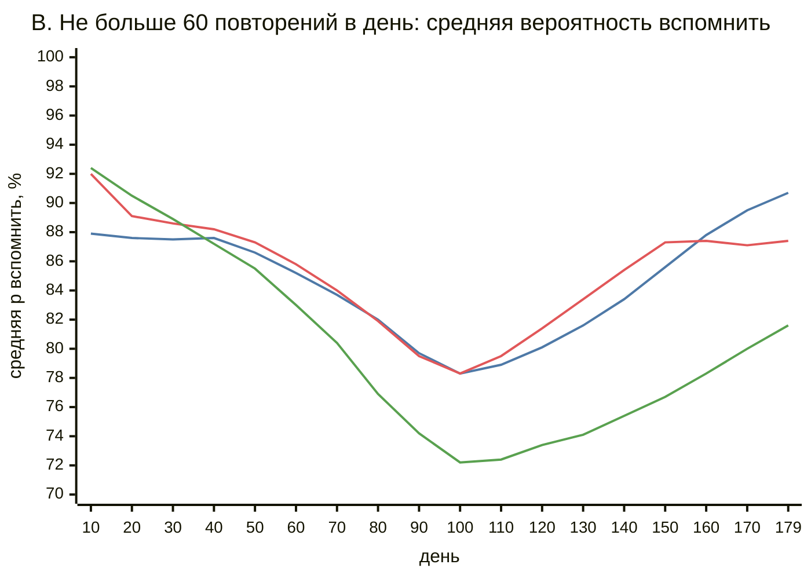
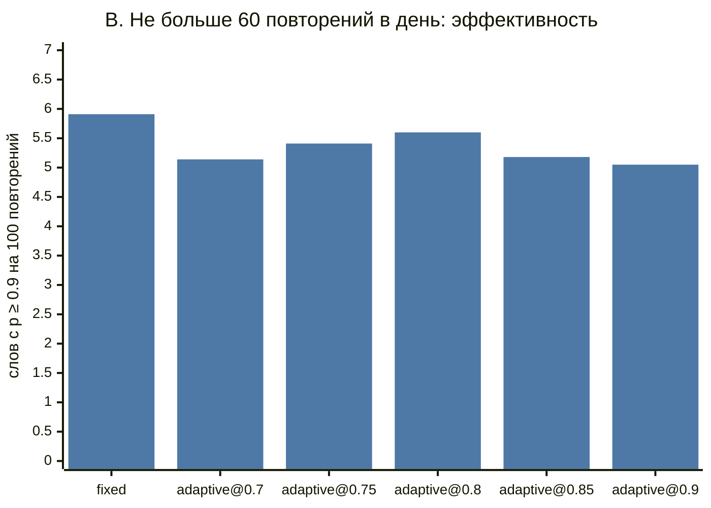

# Фиксированные интервалы против адаптивного планировщика: симуляция

## Коротко

- **Без лимита на число повторений адаптивный планировщик лучше.** При той же нагрузке
  (`adaptive@0.75`: 10 932 повторения против 10 837 у `fixed`) к 180-му дню ученик уверенно
  (p ≥ 0.9) помнит 522 слова против 447, то есть на 17 % больше. Так вышло во всех 10 прогонах из 10.
- **Целевая вероятность вспомнить управляет компромиссом между нагрузкой и удержанием.** При цели 0.9
  удержание растёт до 95 %, но повторений в 2,2 раза больше. Больше всего слов на одно повторение
  дают цели 0.75–0.8.
- **Модель забывания откалибрована в среднем.** Доля верных ответов почти совпадает с целью
  (77 % при цели 0.75, 85 % при 0.85, 90 % при 0.9), хотя форма модели не совпадает с «истинной» памятью ученика.
- **При жёстком лимите в 60 повторений в день преимущество пропадает.** Фиксированный планировщик
  не хуже или лучше любого адаптивного, а адаптивный с высокой целью копит очередь просроченных слов.
  Адаптивному планировщику нужен приоритет очереди по вероятности забывания, а не по дате.

Все числа ниже — результат синтетической симуляции с параметрами, подобранными вручную.
Это проверка механики, а не измерение на людях (см. «Ограничения»).

## Что сравниваем

Оба планировщика отвечают на один вопрос: через сколько дней показать слово снова,
если известна история ответов «помнил / не помнил» (`ReviewEvent` из `SPEC.md`).

**`fixed`: базовая линия.** Лестница интервалов 1, 3, 7, 14, 30, 60, 120 дней. Верный ответ
поднимает слово на ступень выше, ошибка возвращает на первую. Такие лестницы стоят в простых
приложениях с карточками.

**`adaptive@T`: half-life regression** (Settles & Meeder, 2016, модель Duolingo).
Вероятность вспомнить слово через `t` дней:

```
p = 2^(−t / h),    h = 2^(θ · x)
x = [1, √(верных ответов), √(ошибок), последний ответ был ошибкой]
```

`h` — период полураспада памяти в днях, вероятность забывания равна `1 − p`. Веса `θ` общие
для всех слов. Планировщик подбирает их онлайн-градиентным спуском по `(p − y)²` после каждого ответа
и стартует с `θ = 0`, то есть с `h = 1` дня. Следующий показ назначается на момент, когда
предсказанная `p` падает до цели `T`: `t = h · log2(1/T)`. Интервал от 1 до 365 дней.

Код: `srs_sim/schedulers.py`.

## Синтетический ученик

Скрытая «истинная» память устроена по мотивам модели DSR (difficulty / stability / retrievability),
на которой построен FSRS (`srs_sim/learner.py`):

- у каждого слова своя сложность `D ∈ [1, 10]` (Beta(2, 2), растянутое на отрезок), планировщики её не видят;
- стабильность `S` — число дней, за которое вероятность вспомнить падает до 90 %: `R = 0.9^(t/S)`;
- начальная `S` около 1,5 дня, у трудных слов меньше;
- при верном ответе `S` растёт, и тем сильнее, чем ниже было `R` в момент показа (эффект интервалов);
  у трудных и уже стабильных слов рост слабее;
- ошибка умножает `S` на 0.3;
- 2 % «случайных ошибок» даже при живой памяти.

Форма модели специально отличается от модели адаптивного планировщика: другое основание экспоненты,
другие признаки, есть скрытая сложность. Иначе адаптивный планировщик получил бы правильную модель даром.
Параметры ученика были выбраны до первых сравнений и под результат не подгонялись.

## Протокол

- 180 дней. Первые 90 дней ученик каждый день встречает в игре 10 новых слов, всего 900.
  Знакомство не считается повторением.
- Каждый день сначала замеряется средняя истинная `R` по всем словам, потом идут повторения,
  потом появляются новые слова.
- Очередь дня — все слова со сроком ≤ сегодня, сначала самые просроченные. В сценарии B берутся
  только первые 60, остальные ждут следующего дня. Порядок одинаков для обоих планировщиков.
- 10 прогонов (seed'ы 2026–2035), на каждый прогон новый экземпляр планировщика: адаптивный
  не переносит выученные веса между учениками.
- Сравнение парное: при одном seed у обоих планировщиков одни и те же 900 слов с одинаковой сложностью
  (генераторы сложности и ответов независимы).

Метрики:

| Метрика | Что значит |
|---|---|
| Повторений всего | нагрузка на ученика за 180 дней |
| Доля верных ответов | сколько показов закончились «помнил» |
| Средняя вероятность вспомнить в конце | средняя истинная `R` по всем 900 словам на 180-й день |
| Слов с p ≥ 0.9 в конце | сколько слов ученик уверенно помнит в конце |
| Таких слов на 100 повторений | эффективность: польза на единицу нагрузки |
| Просрочено в конце | слова, до которых не дошла очередь из-за лимита |
| Brier score | средний `(p̂ − y)²` прогнозов адаптивного планировщика, меньше — лучше; у `fixed` прогнозов нет |
| Seed'ов, где лучше `fixed` | в скольких из 10 парных прогонов слов с p ≥ 0.9 строго больше |

## Результаты

<!-- AUTO:BEGIN — генерируется `python -m srs_sim`, не править руками -->

Seed'ы: 2026…2035 (10 прогонов на каждую строку), 180 дней, новые слова первые 90 дней по 10 в день (всего 900). Значения — среднее ± стандартное отклонение по прогонам.

### A. Без лимита повторений

| Планировщик | Повторений всего | Доля верных ответов, % | Средняя вероятность вспомнить в конце, % | Слов с p ≥ 0.9 в конце | Таких слов на 100 повторений | Просрочено в конце | Brier score | Seed'ов, где слов с p ≥ 0.9 больше, чем у fixed |
|---|---:|---:|---:|---:|---:|---:|---:|---:|
| `fixed` | 10837 ± 148 | 78.0 ± 0.4 | 88.2 ± 0.3 | 447 ± 13 | 4.12 ± 0.15 | 0 ± 0 | — | — |
| `adaptive@0.7` | 9766 ± 291 | 73.1 ± 0.3 | 87.1 ± 0.5 | 461 ± 21 | 4.73 ± 0.27 | 0 ± 0 | 0.197 ± 0.001 | 8/10 |
| `adaptive@0.75` | 10932 ± 278 | 77.1 ± 0.3 | 89.0 ± 0.5 | 522 ± 24 | 4.78 ± 0.19 | 0 ± 0 | 0.177 ± 0.002 | 10/10 |
| `adaptive@0.8` | 13053 ± 459 | 81.4 ± 0.2 | 91.1 ± 0.4 | 612 ± 23 | 4.70 ± 0.28 | 0 ± 0 | 0.152 ± 0.001 | 10/10 |
| `adaptive@0.85` | 16212 ± 591 | 85.3 ± 0.2 | 93.2 ± 0.3 | 726 ± 17 | 4.49 ± 0.17 | 0 ± 0 | 0.126 ± 0.001 | 10/10 |
| `adaptive@0.9` | 23665 ± 978 | 89.7 ± 0.2 | 95.4 ± 0.3 | 827 ± 9 | 3.50 ± 0.16 | 0 ± 0 | 0.093 ± 0.001 | 10/10 |



Линии (mermaid не рисует легенду): #4e79a7 — `fixed`, #e15759 — `adaptive@0.75`, #59a14f — `adaptive@0.85`.



### B. Не больше 60 повторений в день

| Планировщик | Повторений всего | Доля верных ответов, % | Средняя вероятность вспомнить в конце, % | Слов с p ≥ 0.9 в конце | Таких слов на 100 повторений | Просрочено в конце | Brier score | Seed'ов, где слов с p ≥ 0.9 больше, чем у fixed |
|---|---:|---:|---:|---:|---:|---:|---:|---:|
| `fixed` | 10029 ± 69 | 64.1 ± 2.4 | 90.7 ± 0.5 | 593 ± 14 | 5.91 ± 0.11 | 36 ± 36 | — | — |
| `adaptive@0.7` | 9354 ± 184 | 65.0 ± 2.3 | 86.0 ± 0.7 | 481 ± 20 | 5.14 ± 0.22 | 0 ± 0 | 0.203 ± 0.001 | 0/10 |
| `adaptive@0.75` | 10015 ± 137 | 64.3 ± 2.3 | 87.5 ± 1.1 | 542 ± 42 | 5.41 ± 0.39 | 0 ± 0 | 0.187 ± 0.002 | 1/10 |
| `adaptive@0.8` | 10510 ± 45 | 60.7 ± 2.4 | 88.7 ± 1.0 | 589 ± 29 | 5.60 ± 0.28 | 54 ± 49 | 0.170 ± 0.004 | 4/10 |
| `adaptive@0.85` | 10589 ± 2 | 57.2 ± 2.3 | 81.7 ± 3.2 | 548 ± 39 | 5.18 ± 0.37 | 284 ± 47 | 0.146 ± 0.004 | 1/10 |
| `adaptive@0.9` | 10590 ± 0 | 56.6 ± 1.4 | 74.8 ± 1.5 | 535 ± 17 | 5.05 ± 0.16 | 418 ± 24 | 0.128 ± 0.003 | 0/10 |



Линии (mermaid не рисует легенду): #4e79a7 — `fixed`, #e15759 — `adaptive@0.75`, #59a14f — `adaptive@0.85`.



<!-- AUTO:END -->

## Вывод

**Сценарий A (без лимита).** Адаптивный планировщик выигрывает у фиксированной лестницы при любой
нагрузке, которую можно сравнить:

- при равной нагрузке (`adaptive@0.75`, +0,9 % повторений) слов с p ≥ 0.9 на 17 % больше (522 против 447),
  средняя вероятность вспомнить 89,0 % против 88,2 %, преимущество в 10 прогонах из 10;
- при меньшей нагрузке (`adaptive@0.7`, на 10 % меньше повторений) уверенно помнимых слов всё ещё
  чуть больше (461 против 447, 8 из 10 прогонов), хотя средняя `R` немного ниже (87,1 % против 88,2 %);
- эффективность (слов на 100 повторений) у адаптивного 4,5–4,8 при целях 0.7–0.85 против 4,1 у `fixed`.
  При цели 0.9 эффективность падает до 3,5: последние проценты удержания стоят дорого.

Выигрыш объясняется тем, что лестница одинакова для всех слов. Лёгкие слова она показывает слишком
часто, а трудные после ошибки снова проходят всю лестницу с первой ступени. Адаптивная модель
через признак «число ошибок» растягивает интервалы лёгких слов и сжимает интервалы трудных.

Модель вероятности забывания полезна и сама по себе: доля верных ответов отличается от цели
на 0,3–3 п.п., хотя модель задана неверно (HLR против DSR). Отклонение всегда в плюс и больше
при низких целях. Причину отдельно не исследовал. Возможные объяснения: округление интервалов
до целых дней и то, что онлайн-обучение отстаёт от растущей стабильности памяти. Значит, параметр `T` можно показывать
пользователю как понятную настройку: «хочу помнить 80 % слов при повторении».

**Сценарий B (не больше 60 повторений в день).** Здесь преимущество исчезает:

- `fixed` даёт больше всего слов с p ≥ 0.9 (593) и самую высокую среднюю `R` (90,7 %);
  `adaptive@0.8` догоняет его по числу слов (589, лучше в 4 из 10 прогонов), остальные цели хуже;
- при целях 0.85 и 0.9 адаптивный планировщик просит больше повторений, чем позволяет лимит,
  и к концу у него 284–418 просроченных слов.

Причина в том, что адаптивный планировщик не знает про лимит. Очередь отсортирована по дате, поэтому
лимит тратится на самые просроченные слова, которые ученик уже забыл. Выводы для основного приложения (V4):

1. если лимита на повторения нет, адаптивный планировщик с целью около 0.8 — разумный выбор по умолчанию;
2. если лимит появится, очередь нужно сортировать по предсказанной вероятности забывания или по
   ожидаемой пользе от показа, а цель `T` подбирать под лимит. Без этого фиксированная лестница надёжнее.

Ещё одно наблюдение: у `fixed` средняя `R` в сценарии B выше, чем в A (90,7 % против 88,2 %), хотя
повторений меньше. Лимит вынужденно удлиняет интервалы, а синтетический ученик сильно вознаграждает
поздние успешные повторения. Это говорит скорее о модели ученика (см. ограничение 2) и о том, что
лестница 1–3–7… для такого ученика слишком частая, чем о пользе лимитов.

## Ограничения симуляции

1. **Ученик синтетический.** Параметры памяти выбраны вручную, а не обучены на реальных ответах.
   Все выводы верны для этой модели. На живых людях выигрыш может оказаться другим и по величине, и по знаку.
2. **Анализа чувствительности нет.** Проверены только два режима лимита. От силы эффекта интервалов
   (`spacing_effect`), штрафа за ошибку и распределения сложности результат может зависеть, особенно в сценарии B.
3. **Модели родственные.** И «истинная» память, и HLR — экспоненциальное забывание со стабильностью,
   которая растёт при успехе. У настоящей памяти отличий от HLR, скорее всего, больше, поэтому
   хорошая калибровка здесь — оптимистичная оценка.
4. **Слова независимы.** Нет интерференции похожих слов и нет встреч со словом вне повторений.
   А в игре пользователь как раз встречает слова снова, и это укрепляет память без всякого планировщика.
5. **Ученик идеален.** Он приходит каждый день, не устаёт, отвечает честно. В приложении «помнил /
   не помнил» — самооценка, она шумная и смещённая.
6. **Адаптивная модель минимальна.** Веса общие для всех слов, признаков слова (длина, частотность,
   часть речи) нет, холодный старт с `h = 1` дня, нет переноса между пользователями.
   Более богатая модель может выиграть больше, но и переобучиться на коротких историях.
7. **Базовая линия не настраивалась.** Лестница 1–3–7–14–30–60–120 — одна разумная из многих.
   Другая лестница (например, с более длинными шагами) могла бы сократить разрыв в сценарии A.
8. **Метрики меряют скрытую `R`.** В реальности её не видно, остаётся только доля верных ответов. Замер
   в один день (180-й) зависит ещё и от того, на какой фазе расписания оказалось каждое слово.
9. **Время дискретное.** Интервалы округляются до целых дней, адаптивный не может назначить меньше дня.
10. **Воспроизводимость привязана к версии Python.** Числа получены на Python 3.13. Модуль `random`
    гарантирует одинаковые `random()` при одинаковом seed, но не обещает неизменности
    `betavariate` между версиями. На другой версии числа могут чуть отличаться, выводы не должны.

## Как воспроизвести

```bash
cd srs
python3 -m srs_sim            # ~30 секунд, перезаписывает блок «Результаты» в REPORT.md
python3 -m unittest discover -s tests -t .
SRS_FULL=1 python3 -m unittest tests.test_reproducibility   # сверяет REPORT.md с новым прогоном
```

Только стандартная библиотека Python 3.11+, без внешних зависимостей. Seed'ы зафиксированы
в `srs_sim/experiment.py` (`SEED = 2026`, `N_RUNS = 10`).
